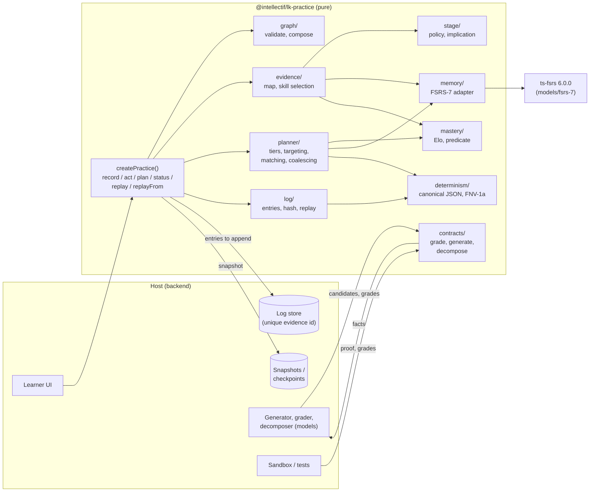
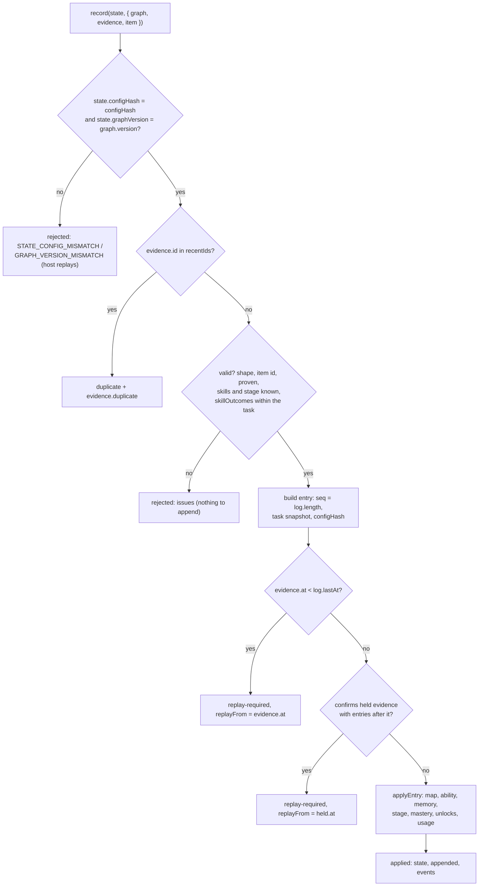
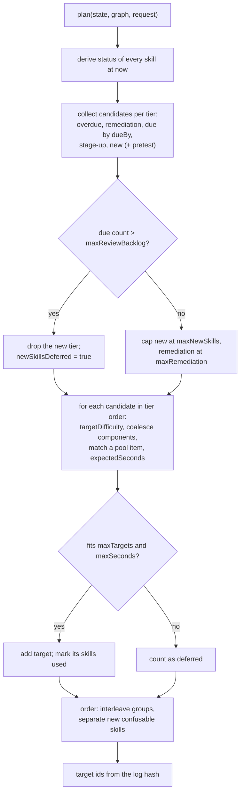
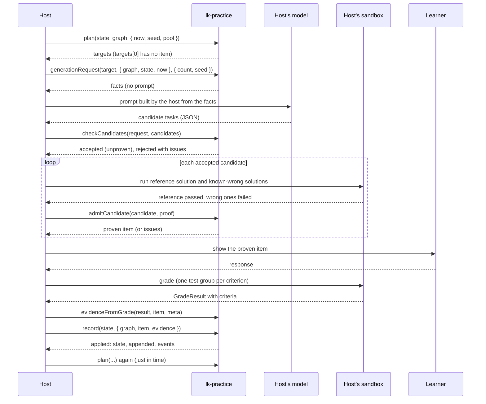
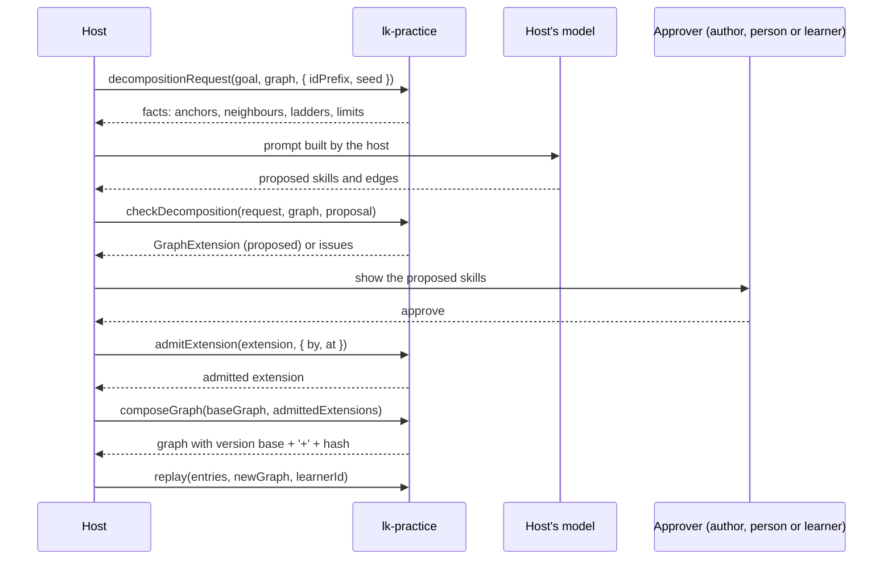

# `@intellectif/lk-practice` - design

**Status:** design for the build, matching [the requirements](lk-sdk-practice-requirements.md) as revised on 2026-11-01, including the design-review pass of the same date (D26-D28). Nothing is implemented.
**Audience:** whoever builds the package, milestone by milestone ([lk-practice-milestones.md](lk-practice-milestones.md)).
**Why this file is in `docs/`:** `lk-azure`'s plan lived in `docs/internal/`, but `.gitignore` lists `docs/internal/`, so a file there is never committed, reviewed or checked. This design sits beside the requirements so `pnpm docs-check` validates its links and fenced imports (D11). Like the requirements, it names the package's proposed exports in comments, never in `import` lines, because the package has no API report yet.

Requirement numbers (R…) and decisions (D…) refer to the requirements document.

---

## 1. Context and goals

The package answers one question for a learning product: **which skills should this learner retrieve next, in what form, at what difficulty, and when again?** It keeps:

- one **memory** per skill at its current stage, scheduled by FSRS-7 through `ts-fsrs` 6 (D1, D14);
- one **ability** per skill and stage, an Elo `theta` on a logit scale, with task difficulty relative to its stage (D4, D27);
- a **stage** per skill on a ladder from example to transfer (R3.1, R3.2);
- the readiness of each skill from the host's prerequisite graph (R3.3).

It returns **practice targets**; the host's AI makes a task for each, the package checks the task, the host proves it, and the graded attempt comes back as evidence for each skill the task exercised (D17, D18, D19).

Design goals, in priority order:

1. **Correct and replayable.** The log is the source of truth; `record` equals "append, then replay incrementally" (R5.3).
2. **Pure.** No clock, randomness, network or I/O in the package (R1.1).
3. **Small, typed surface.** Everything exported has a written-out type and is frozen by `api-report` (R10.3).
4. **Domain-agnostic.** Nothing about Python, English or CEFR in the core.
5. **Fast enough** for a request path: `record` under 1 ms, `plan` under 50 ms at 2,000 skills (R12.4).

Non-goals are those of the requirements: storage, prompts, model calls, UI, delivery and code execution are the host's.

## 2. What ships when

| Capability | `0.1.0` (MVP) | Later |
|---|---|---|
| Graph and item validation, graph extensions and `composeGraph` | yes | - |
| FSRS-7 memory per skill and stage, pinned short-term defaults | yes | `costAdr` option; opt-in `fsrs-6` id |
| Elo ability per skill and stage, `prior` host action | yes | hierarchical model (D25), BKT |
| Evidence mapping with skill outcomes, held evidence, implication rule | yes | - |
| Planner: tiers, difficulty targeting, matching, coalescing, ordering, pretest option | yes | graph credit (Phase 3, D6) |
| Log, snapshot, `replay`, `replayFrom`, host actions, events, state v1 | yes | later schema versions |
| Grader, generator (with proof gate) and decomposition contracts | yes | - |
| `./testing` simulator and vectors | yes | - |
| `./lk-core` structural adapter and contract test | no (first `0.x` minor after `0.1.0`) | yes |

## 3. Architecture



Rules the layout enforces:

- Only `memory/fsrs.ts` imports `ts-fsrs`, and only from `ts-fsrs/models/fsrs-7` and `ts-fsrs/middlewares` plus the scheduler factory; no exported type names a `ts-fsrs` type (R4.2).
- No module outside `adapters/lk-core/` mentions `lk-core`, and that folder imports nothing from it: it declares structural types (D2).
- `determinism/` has no dependencies; every hash, key and canonical form goes through it.
- Every module is a set of pure functions over plain data; `createPractice` only binds the resolved configuration (plain data, D26) and keeps the model and policy instances in its closure; no function ever enters the resolved configuration or a hash.

## 4. Module layout

```text
packages/lk-practice/
  package.json            name, private: true until M9, engines >=24, exports . ./lk-core ./testing
  tsdown.config.ts        same settings as lk-core (neutral, es2022, esm + cjs, dts)
  tsconfig.json           extends the repository base (strict, exactOptionalPropertyTypes)
  tsconfig.typecheck.json typecheck of src and test, as lk-azure (script: typecheck)
  LICENSE                 MIT, copied from lk-azure
  vitest.config.ts        coverage thresholds: 80% global, 100% for the gated modules
  README.md               npm page (written at M9)
  CHANGELOG.md            created by Changesets at the first release
  api/surface.md          generated by scripts/api-report.mjs
  scripts/verify-dist.mjs static scan + runtime purity trap + export checks
  vectors/                graph, memory, evidence, stage, log, plan, contracts .json + replay.mjs
                          (revised in M5: the log vectors are log.json, not replay.json, so the
                          file is not confused with the replay.mjs runner)
  scripts/policy-vectors.mjs  writes vectors/evidence.json and vectors/stage.json (revised in M4)
  scripts/log-vectors.mjs     writes vectors/log.json (revised in M5)
  scripts/load-src.mjs        bundles src/ for the vector generators, shared (revised in M5)
  bench/plan.bench.mjs    performance tracking, outside CI gates
  src/
    index.ts              root entry: re-exports only
    errors.ts             PracticeConfigError (revised in M4)
    types.ts              public domain types (graph, items, evidence, state, plan, events)
    config.ts             PracticeConfig, defaults, resolveConfig, validation, configHash
    practice.ts           createPractice: binds config and models; record, act, plan, status, replay...
    determinism/
      canonical.ts        canonicalJson
      fnv.ts              fnv1a64
      keys.ts             tieKey, targetId, logHash step (M5: the log hash step; the others in M6)
      freeze.ts           deepFreeze for returned values (revised in M5)
    graph/
      validate.ts         validateGraph, validateItems
      index.ts            adjacency, topological order, ladders per skill
      stages.ts           stage demand, validation and equivalent stages (R3.8, D28)
      extension.ts        GraphExtension checks, composeGraph
    memory/
      port.ts             MemoryModel, MemoryReview, ReviewContext
      fsrs.ts             fsrsMemoryModel (the only ts-fsrs import)
    mastery/
      port.ts             MasteryModel, MasteryObservation, MasteryEstimate
      elo.ts              eloMasteryModel
      ability.ts          abilityAt, updateAbility: ability per stage and derive (8.5) (revised in M4)
      predicate.ts        isMastered, status derivation
    evidence/
      map.ts              mapEvidence: source -> rating, correct, weight
      skills.ts           skill selection (R7.4), weight floor, not-assessed
    stage/
      policy.ts           StagePolicy default: promote, demote
      implication.ts      the implication rule (D15)
    log/                  (revised in M5: the files as built; usage.ts became part of draft.ts)
      entries.ts          taskSnapshot, the evidence and host entries record and act append
      context.ts          Engine (the bound models, built once) and GraphIndex (per call)
      draft.ts            working copy of a state: skills, item usage and pruning, held, ids, events
      validate.ts         the checks record, act, replay and replayFrom share
      apply.ts            applyEntry(draft, entry, context, link): the one state transition
      record.ts           record and act: validation, ordering checks, held handling
      replay.ts           replay, replayFrom, look-ahead confirmation
      index.ts            internal re-exports
    planner/
      candidates.ts       per-tier candidate collection
      difficulty.ts       target difficulty, expected success
      match.ts            pool item matching
      coalesce.ts         composite and component merging
      order.ts            interleaving and ordering
      plan.ts             plan(): budget fill, reasons, deferred counts
    status/
      summary.ts          status(), reconcile()
    contracts/
      grade.ts            GradeRequest, GradeResult, checkGradeResult, evidenceFromGrade
      generate.ts         generationRequest, checkCandidates, admitCandidate
      decompose.ts        decompositionRequest, checkDecomposition, admitExtension
    schema/
      shape.ts            strict, total shape checks of the stored JSON, state v1 (revised in M5)
      migrate.ts          migrateState (M5)
      standard.ts         StandardSchemaV1 type (structural copy of the spec) (M7)
      schemas.ts          practiceStateSchema, evidenceSchema, reviewLogEntrySchema, gradeResultSchema (M7)
      json.ts             JSON Schema objects (M7)
    adapters/lk-core/     (M10)
      types.ts            structural copies: ItemOutcomeLike, GradeRecordLike, CriterionScoreLike
      index.ts            evidenceFromOutcome, skillOutcomesFromCriteria
    testing/
      index.ts            simulateLearner, vector helpers
  src/**/__tests__/        tests beside each module, as lk-core and lk-azure do:
    *.test.ts             unit tests
    *.property.test.ts    fast-check property tests
  src/__tests__/purity.test.ts             runtime trap over dist (also run by verify-dist)
  src/adapters/lk-core/__tests__/contract.test.ts  (M10) real lk-core types and evaluate outputs
```

`index.ts` re-exports only; `api-report` freezes the result. Internal helpers (canonical JSON, FNV-1a) are not exported from the root; `./testing` exposes what a port or a conformance test needs.

## 5. Public types

All public types are written out (R10.3). Blocks 5.1 to 5.4 repeat the requirements verbatim so this section is complete; the requirements stay normative for them, and a change is made in both places in the same pull request. Blocks 5.5 to 5.10 are defined here. Every field is `readonly`; every number is finite; every instant is integer epoch milliseconds (D12).

### 5.1 Graph, items and evidence (R2, R7)

```ts
// Skill graph - supplied by the host; the package validates it and never edits it.
export interface SkillGraph {
  readonly version: string; // the host's own version tag, recorded in state
  readonly skills: readonly SkillNode[];
  readonly edges: readonly SkillEdge[];
}

export interface SkillNode {
  readonly id: string;
  readonly knowledge: 'declarative' | 'procedural' | 'mixed';
  readonly stages?: readonly StageId[]; // overrides the default ladder for this skill
  readonly interleaveGroup?: string; // skills in one group are confusable, so interleave them
  readonly tags?: readonly string[]; // host data, opaque to the package (e.g. a CEFR band)
  readonly label?: string; // host text, passed to generators as a fact; never interpreted
  readonly description?: string; // host text, e.g. a can-do statement; never interpreted
  readonly criteriaHint?: string; // host text: how a grader can isolate this skill as a criterion; passed to generators, never interpreted
  readonly forms?: Readonly<Record<StageId, readonly string[]>>; // the host's task-form vocabulary per stage
  readonly masteryPrior?: number; // initial ability at the first stage, in logits on the Elo scale (default 0)
  readonly referenceDifficulty?: number; // the standard a master meets on a top-stage task, in stage-relative logits (default 0)
  readonly desiredRetention?: number; // per-skill override (R4.6)
}

export type SkillEdge =
  | {
      readonly kind: 'prerequisite';
      readonly from: string; // must be mastered or credited...
      readonly to: string; // ...before this is introduced (if hard)
      readonly strength: 'hard' | 'soft';
    }
  | {
      readonly kind: 'encompasses';
      readonly from: string; // the composite skill
      readonly to: string; // a component it exercises
      readonly weight: number; // 0 < weight <= 1
    };

export type StageId = string; // ladders are data, see §3

// Items - one disposable, practisable instance at one stage of one or more skills.
export interface PracticeItem {
  readonly id: string;
  readonly skills: readonly ItemSkill[]; // the primary skill has the largest weight
  readonly stage: StageId; // in the primary skill's ladder; each other skill has it or an equivalent stage (R2.2, R3.8)
  readonly difficulty?: number; // author or generator prior, in logits relative to the stage (default 0 = a typical task at this stage; about -2 easy, +2 hard)
  readonly expectedSeconds?: number; // for session budgets
  readonly fluentSeconds?: number; // optional: at or under this, a first-try success may map to 'easy'
  readonly slowSeconds?: number; // optional: above this, a first-try, no-hint pass maps to 'hard' (R7.2)
  readonly criteria?: readonly ItemCriterion[]; // grader criterion or test group -> component skill (R7.2)
  readonly form?: string; // one of the skill's `forms` for this stage, if the host uses them
  readonly contentHash?: string; // lets the host and the generator check detect repeats
  readonly origin: 'authored' | 'generated';
  readonly status: 'proven' | 'unproven'; // only proven items are planned or recorded (§9)
  readonly proof?: CandidateProof;
}

export interface ItemSkill {
  readonly skillId: string;
  readonly weight: number; // the weights of one item sum to 1
}

export interface ItemCriterion {
  readonly name: string; // a rubric criterion name or a test group, as the grader reports it
  readonly skillId: string; // one of the item's skills, or a component one of them encompasses
}

// Evidence - what happened, from any source.
export interface Evidence {
  readonly id: string; // idempotency key; the host's log store makes it unique (R11.6)
  readonly itemId: string;
  readonly at: number; // epoch ms, host clock
  readonly source: EvidenceSource;
  readonly context?: 'practice' | 'exam' | 'diagnostic' | 'pretest'; // default 'practice'
  readonly targetId?: string; // the plan target this attempt answered, for the host's analytics
  readonly durationMs?: number;
  readonly hintsUsed?: number;
  readonly attempts?: number; // failed tries before the one that counts
  readonly skillOutcomes?: readonly SkillOutcome[]; // per-component outcomes (R7.2)
  readonly learnerConfidence?: 'sure' | 'unsure' | 'guess'; // asked before feedback (R7.8)
  readonly confirms?: string; // id of held evidence this confirms or overrides (§7)
  readonly supplements?: string; // id of evidence for the same attempt: updates ability only (R7.2)
}

export interface SkillOutcome {
  readonly skillId: string;
  readonly score: number;
  readonly maxScore: number;
  readonly passed?: boolean; // default: score === maxScore
}

export type EvidenceSource =
  | {
      readonly kind: 'auto';
      readonly score: number;
      readonly maxScore: number;
      readonly passed: boolean;
      readonly checks?: { readonly passed: number; readonly total: number };
    }
  | {
      readonly kind: 'ai';
      readonly score: number;
      readonly maxScore: number;
      readonly passed: boolean;
      readonly confidence: 'high' | 'medium' | 'low';
      readonly requiresHumanReview?: boolean;
      readonly graderId?: string;
    }
  | {
      readonly kind: 'human';
      readonly score: number;
      readonly maxScore: number;
      readonly passed: boolean;
      readonly graderId?: string;
    }
  | { readonly kind: 'self'; readonly rating: Rating }
  | { readonly kind: 'exposure' } // seen or studied, no retrieval (e.g. a worked example)
  | { readonly kind: 'pending'; readonly reason: 'deferred' | 'routed-to-person' }; // graded later: held

export type Rating = 'again' | 'hard' | 'good' | 'easy';
```

### 5.2 Model ports (R4, R5)

```ts
export interface MemoryModel<M = unknown> {
  readonly id: string; // 'fsrs-7' (default)
  readonly version: number; // a change in output is a new version, and a package major
  readonly params: JsonValue; // the instance's resolved options (FSRS-7: weights and steps); enters the config hash (D26)
  init(): M; // a memory with no reviews
  retrievability(memory: M, now: number): number; // 0..1; pure and cheap, called by plan and status (R12.4)
  review(memory: M, rating: Rating, now: number, context: ReviewContext): MemoryReview<M>;
  serialize(memory: M): unknown;
  deserialize(raw: unknown): M; // throws a typed error on bad input
}

export interface MemoryReview<M> {
  readonly memory: M;
  readonly due: number; // integer epoch ms
}

// (revised in M5) Only the retention: the steps and the maximum interval are the
// model's own options (FsrsOptions), which enter its params and the configuration hash.
export interface ReviewContext {
  readonly desiredRetention: number;
}

export interface MasteryModel<S = unknown> {
  readonly id: string; // 'elo', later perhaps 'elo-hierarchical' or 'bkt'
  readonly version: number;
  readonly params: JsonValue; // e.g. Elo alpha and beta; enters the config hash (D26)
  init(skill: SkillNode): S; // the ability at the skill's first stage
  update(state: S, observation: MasteryObservation): S;
  prior(state: S, theta: number, pseudoCount: number): S; // a host 'prior' action at one stage (R5.5)
  derive(from: S, shift: number): S; // the ability at another stage: value minus shift, fresh uncertainty (D27)
  expectedSuccess(state: S, difficulty: number): number; // 0..1
  estimate(state: S): MasteryEstimate;
  serialize(state: S): unknown;
  deserialize(raw: unknown): S;
}

export interface MasteryObservation {
  readonly correct: number; // 0..1, partial credit allowed
  readonly weight: number; // 0..1, from the evidence mapping
  readonly difficulty: number; // the task's prior, relative to its stage, on this model's scale
  readonly stage: StageId; // the stage whose ability this updates: the skill's equivalent of the task's stage (R3.8)
  readonly context: 'practice' | 'exam' | 'diagnostic' | 'pretest';
}

export interface MasteryEstimate {
  readonly model: string; // e.g. 'elo@1'
  readonly value: number; // theta for Elo
  readonly uncertainty?: number; // K(n) for Elo
  readonly evidenceCount: number;
}

// Default-model options. The defaults are pinned in the package, not read from ts-fsrs (R4.5).
export interface FsrsOptions {
  readonly weights?: readonly number[]; // fitted FSRS-7 weights (R4.8); default: the library's FSRS-7 defaults, copied
  readonly learningSteps?: readonly string[]; // default ['1m', '10m']
  readonly relearningSteps?: readonly string[]; // default ['10m']
  readonly maximumIntervalDays?: number; // default 36500
}

export interface EloOptions {
  readonly alpha?: number; // default 1
  readonly beta?: number; // default 0.05
}

// Replaceable policies (R1.4). A custom policy declares an id, a version and data params, which enter the config hash (D26).
export interface StagePolicy {
  readonly id: string; // 'stage-default'
  readonly version: number;
  readonly params: JsonValue; // the built-in policy: its resolved StagePolicyOptions
  decide(input: StageDecisionInput): StageDecision;
}

export interface StageDecisionInput {
  readonly ladder: readonly StageId[];
  readonly current: StageId;
  readonly evidenceStage: StageId; // the skill's equivalent of the task's stage (R3.8)
  readonly rating: Rating;
  readonly at: number;
  readonly streak: StageStreak;
}

export interface StageDecision {
  readonly effect: 'success' | 'lapse' | 'review' | 'neutral'; // after the implication rule (D15); 'review' (revised in M4): reviewed, streak unchanged
  readonly move: 'promote' | 'demote' | 'stay';
  readonly streak: StageStreak; // the streak after this retrieval (reset on a move)
  readonly dueCap: number | null; // lastSuccessAt + gap while 0 < counted successes < K, else null (R3.2)
}

export interface EvidenceMapper {
  readonly id: string; // 'evidence-default'
  readonly version: number;
  readonly params: JsonValue; // the built-in mapper: its resolved EvidenceOptions
  map(evidence: Evidence, task: TaskSnapshot, skills: SkillStatesView, config: ResolvedPracticeConfig): MappedEvidence;
}

export interface MappedEvidence {
  readonly held: boolean;
  readonly perSkill: readonly SkillEffect[];
}

export interface SkillEffect {
  readonly skillId: string;
  readonly rating: Rating | null;
  readonly correct: number; // 0..1
  readonly weight: number; // 0..1, ability weight (evidence weight x item weight, or the outcome's)
  readonly memory: 'review' | 'none';
  readonly reason:
    | 'outcome' // from a skillOutcomes entry
    | 'overall' // the overall outcome, item weight at or above the floor
    | 'below-weight-floor'
    | 'not-assessed'
    | 'exposure'
    | 'supplement'
    | 'context' // exam pass, diagnostic or pretest: no memory review
    | 'held';
}

export type SkillStatesView = Readonly<Record<string, { readonly stage: StageId }>>;
```

### 5.3 Planning (R6)

```ts
export interface PlanRequest {
  readonly now: number;
  readonly dueBy?: number; // include retrievals due up to this instant; defaults to `now` (R1.2)
  readonly seed: string;
  readonly budget: { readonly maxTargets?: number; readonly maxSeconds?: number };
  readonly limits?: {
    readonly maxNewSkills?: number;
    readonly maxReviewBacklog?: number;
    readonly maxRemediation?: number;
    readonly maxSkillsPerTarget?: number;
  };
  readonly focusSkills?: readonly string[]; // a host-chosen goal, e.g. a lesson's objectives
  readonly excludeSkills?: readonly string[]; // skills the host cannot practise now
  readonly excludeItems?: readonly string[]; // item ids the host cannot show now
  readonly pool?: readonly PracticeItem[]; // proven items the planner may attach to targets
}

export interface SessionPlan {
  readonly targets: readonly PracticeTarget[];
  readonly deferred: { readonly reviewsDue: number; readonly newReady: number };
  readonly budgetUsed: { readonly targets: number; readonly seconds: number };
  readonly algorithm: { readonly id: 'planner'; readonly version: number };
}

export interface PracticeTarget {
  readonly id: string; // deterministic (D23)
  readonly kind: 'review' | 'new' | 'stage-up' | 'remediation' | 'pretest';
  readonly skillIds: readonly string[]; // the primary skill first, then coalesced components
  readonly stage: StageId;
  readonly targetDifficulty: number; // logits: Elo expected success equals targetSuccess here
  readonly difficultyTolerance: number; // a generated task should land within this of the target
  readonly expectedSeconds: number;
  readonly constraints: TaskConstraints;
  readonly item?: { readonly itemId: string; readonly difficulty: number; readonly expectedSuccess: number };
  readonly reason: PlanReason; // structured codes and ids, never prose
}

export interface TaskConstraints {
  readonly forms?: readonly string[]; // the skill's `forms` for this stage, if any
  readonly needsSkillOutcomes: boolean; // true when several skills must each be graded
  readonly avoidItemIds: readonly string[]; // recently used instances
  readonly avoidContentHashes: readonly string[];
  readonly context: 'practice' | 'pretest';
}

export type PlanReason = PlanReasonDetail & {
  readonly expectedSuccess: number; // Elo expected success at targetDifficulty (equals targetSuccess)
  readonly coalesced: readonly string[]; // component ids that joined this target (R6.4c)
  readonly newSkillsDeferred: boolean; // true when the review backlog blocked new skills (R6.8)
};

export type PlanReasonDetail =
  | { readonly code: 'overdue'; readonly due: number; readonly retrievability: number }
  | { readonly code: 'remediation'; readonly lapsedSkillId: string; readonly lapseAt: number; readonly retrievability: number }
  | { readonly code: 'due'; readonly due: number; readonly retrievability: number }
  | { readonly code: 'stage-up'; readonly fromStage: StageId | null }
  | { readonly code: 'new'; readonly focus: boolean; readonly softPrerequisitesMastered: boolean }
  | { readonly code: 'pretest'; readonly forSkillId: string };
```

### 5.4 Grader contract (R8)

```ts
export interface GradeRequest<Response = unknown> {
  readonly itemId: string;
  readonly stage: StageId;
  readonly skillIds: readonly string[];
  readonly criteria?: readonly ItemCriterion[]; // grade each of these separately, when present
  readonly response: Response; // e.g. code, an answer, a transcript
  readonly reference?: unknown; // e.g. a reference solution or answer key, host-defined
  readonly rubric?: readonly RubricCriterion[];
}

export interface RubricCriterion {
  readonly name: string;
  readonly maxScore: number;
  readonly description: string;
}

export interface GradeResult {
  readonly score: number;
  readonly maxScore: number;
  readonly passed: boolean;
  readonly confidence?: 'high' | 'medium' | 'low';
  readonly requiresHumanReview?: boolean;
  readonly checks?: { readonly passed: number; readonly total: number };
  readonly criteria?: readonly { readonly name: string; readonly score: number; readonly maxScore: number }[];
  readonly feedback?: string;
  readonly grader: {
    readonly kind: 'auto' | 'ai' | 'human';
    readonly id?: string;
    readonly model?: string;
    readonly promptHash?: string;
  };
}

// Implemented by the host (a test sandbox, a model, a person's queue).
export type Grader<Response = unknown> = (request: GradeRequest<Response>) => Promise<GradeResult>;
```

### 5.5 Generator and decomposition contracts (R9)

```ts
export interface GenerationContext {
  readonly graph: SkillGraph;
  readonly state: PracticeState;
  readonly now: number;
}

export interface GenerationOptions {
  readonly count: number; // 1..20
  readonly seed: string;
}

// Facts only; no prompt (R9.1).
export interface GenerationRequest {
  readonly version: 1;
  readonly target: {
    readonly id: string;
    readonly kind: PracticeTarget['kind'];
    readonly stage: StageId;
    readonly targetDifficulty: number;
    readonly difficultyTolerance: number;
    readonly expectedSuccess: number;
    readonly expectedSeconds: number;
    readonly context: 'practice' | 'pretest';
  };
  readonly skills: readonly {
    readonly id: string;
    readonly role: 'primary' | 'component';
    readonly knowledge: SkillNode['knowledge'];
    readonly ladder: readonly StageId[];
    readonly stage: StageId; // this skill's equivalent of the target's stage (R3.8)
    readonly forms?: readonly string[]; // SkillNode.forms[stage], when the host set them
    readonly expectedSuccess: number; // at the target difficulty, from this skill's ability at `stage`
    readonly referenceDifficulty: number;
    readonly criteriaHint?: string; // host text: how a grader can isolate this skill
    readonly label?: string;
    readonly description?: string;
    readonly tags?: readonly string[];
  }[];
  readonly forms?: readonly string[]; // the target's allowed forms; a candidate's declared form must be one of them
  readonly needsSkillOutcomes: boolean;
  readonly avoid: { readonly itemIds: readonly string[]; readonly contentHashes: readonly string[] };
  readonly learner: {
    readonly recentLapses: readonly { readonly skillId: string; readonly at: number }[];
    readonly weakest: readonly { readonly skillId: string; readonly theta: number }[];
  };
  readonly count: number;
  readonly seed: string;
}

// What a generator returns per task, after checkCandidates. `content` is the host's and passes through untouched.
export interface CandidateItem extends PracticeItem {
  readonly origin: 'generated';
  readonly status: 'unproven';
  readonly content: unknown;
  readonly contentHash: string; // the generator's own, or fnv1a64(canonicalJson(content)) when absent
}

export interface CandidateCheck {
  readonly accepted: readonly CandidateItem[];
  readonly rejected: readonly { readonly index: number; readonly issues: readonly Issue[] }[];
}

export type CandidateProof =
  | {
      readonly kind: 'executable';
      readonly at: number;
      readonly referencePassed: true;
      readonly wrongSolutionsFailed: number; // at least 1
      readonly runner?: string; // e.g. 'pytest'
    }
  | { readonly kind: 'reviewed'; readonly at: number; readonly reviewerId: string }
  | { readonly kind: 'model-checked'; readonly at: number; readonly model: string; readonly agreed: true };

export type AdmitResult =
  | { readonly ok: true; readonly item: PracticeItem } // origin 'generated', status 'proven', proof set, no content
  | { readonly ok: false; readonly issues: readonly Issue[] }; // PROOF_NOT_ACCEPTED, PROOF_INCOMPLETE, ...

export type TaskGenerator = (request: GenerationRequest) => Promise<unknown>; // implemented by the host

export interface LearnerGoal {
  readonly id: string;
  readonly text: string; // host text, a fact for the decomposer
  readonly anchorSkillIds: readonly string[]; // existing skills the goal builds on
}

export interface DecompositionOptions {
  readonly idPrefix: string; // new ids equal it or start with it plus '.'
  readonly seed: string;
  readonly maxSkills?: number; // default 12
  readonly knowledge?: readonly SkillNode['knowledge'][]; // default all three
}

export interface DecompositionRequest {
  readonly version: 1;
  readonly goal: LearnerGoal;
  readonly anchors: readonly DecompositionSkillFact[];
  readonly neighbours: readonly DecompositionSkillFact[]; // within two edges of an anchor
  readonly edges: readonly SkillEdge[]; // among anchors and neighbours
  readonly idPrefix: string;
  readonly knowledge: readonly SkillNode['knowledge'][];
  readonly ladders: Readonly<Record<'declarative' | 'procedural', readonly StageId[]>>;
  readonly maxSkills: number;
  readonly seed: string;
}

export interface DecompositionSkillFact {
  readonly id: string;
  readonly knowledge: SkillNode['knowledge'];
  readonly ladder: readonly StageId[];
  readonly label?: string;
}

export interface GraphExtension {
  readonly id: string; // fnv1a64 of its canonical skills and edges
  readonly goalId: string;
  readonly idPrefix: string;
  readonly skills: readonly SkillNode[];
  readonly edges: readonly SkillEdge[];
  readonly status: 'proposed' | 'admitted';
  readonly approval?: ExtensionApproval;
}

export interface ExtensionApproval {
  readonly by: 'author' | 'human' | 'learner';
  readonly at: number;
  readonly approverId?: string;
}

export type DecompositionCheck =
  | { readonly ok: true; readonly extension: GraphExtension }
  | { readonly ok: false; readonly issues: readonly Issue[] };

export type ExtensionAdmission =
  | { readonly ok: true; readonly extension: GraphExtension }
  | { readonly ok: false; readonly issues: readonly Issue[] }; // EXTENSION_NOT_PROPOSED, EXTENSION_LEARNER_NOT_ALLOWED

export type GoalDecomposer = (request: DecompositionRequest) => Promise<unknown>; // implemented by the host
```

### 5.6 State and log (R11, D21)

```ts
export interface PracticeState {
  readonly schemaVersion: 1;
  readonly learnerId: string;
  readonly graphVersion: string;
  readonly configHash: string;
  readonly log: {
    readonly length: number; // entries applied; the next entry's seq
    readonly lastAt: number | null; // the largest `at` applied
    readonly hash: string; // rolling hash in seq order (section 9)
  };
  readonly skills: Readonly<Record<string, SkillState>>; // only skills with history; others are derived
  readonly items: Readonly<Record<string, ItemUsage>>;
  readonly held: readonly HeldEvidence[];
  readonly recentIds: readonly string[]; // newest last, at most recentIdWindow (256)
}

export interface SkillState {
  readonly stage: StageId;
  readonly startedAt: number | null;
  readonly unlockedAt: number | null; // sticky (R3.3)
  readonly credited: boolean;
  readonly suspended: 'leech' | 'host' | null;
  readonly memories: Readonly<Record<StageId, StageMemory>>;
  readonly ability: Readonly<Record<StageId, unknown>>; // per stage, MasteryModel.serialize output; Elo: { theta, n }; missing stages are derived (8.5)
  readonly mastered: boolean; // the predicate after the last entry that touched the skill (R3.5, 8.1 step 6)
  readonly evidenceCount: number;
  readonly lastLapseAt: number | null;
  readonly top: {
    // counted (spaced) successes at the ladder's top stage, for the mastery predicate (R3.5 b)
    readonly successes: number;
    readonly firstSuccessAt: number | null;
    readonly lastSuccessAt: number | null;
    readonly lastWasLapse: boolean;
  };
}

export interface StageMemory {
  readonly model: string; // 'fsrs-7@1'
  readonly memory: unknown; // MemoryModel.serialize output; FSRS-7: plain numbers, read without deserialising (8.4)
  readonly due: number | null; // null before the first retrieval; min(modelDue, the streak's dueCap)
  readonly modelDue: number | null; // the memory model's own due time
  readonly lastReviewAt: number | null;
  readonly reviews: number;
  readonly lapses: number; // for the leech threshold (R4.7)
  readonly streak: StageStreak;
  readonly superseded: boolean;
}

export interface StageStreak {
  readonly successes: number; // counted (spaced) successes (8.2)
  readonly firstSuccessAt: number | null;
  readonly lastSuccessAt: number | null; // the last counted success
  readonly lapses: number;
}

export interface ItemUsage {
  readonly uses: number;
  readonly lastUsedAt: number;
}

export interface HeldEvidence {
  readonly evidenceId: string;
  readonly itemId: string;
  readonly at: number;
  readonly seq: number;
  readonly reason: 'low-confidence' | 'human-review' | 'deferred' | 'routed-to-person';
  // (revised in M5) The held entry's evidence and task snapshot, so a confirmation
  // recorded later can apply it without the log.
  readonly evidence: Evidence;
  readonly task: TaskSnapshot;
}

// What an evidence entry stores about its task, so replay never needs the item (R2.3).
export interface TaskSnapshot {
  readonly itemId: string;
  readonly skills: readonly ItemSkill[];
  readonly stage: StageId;
  readonly difficulty: number; // resolved, default 0
  readonly criteria?: readonly ItemCriterion[];
  readonly fluentSeconds?: number;
  readonly slowSeconds?: number;
  readonly contentHash?: string;
  readonly origin: 'authored' | 'generated';
  readonly proofKind?: CandidateProof['kind'];
}

export type ReviewLogEntry =
  | (LogEntryBase & {
      readonly kind: 'evidence';
      readonly evidence: Evidence;
      readonly task?: TaskSnapshot; // absent only on a confirmation, which uses the held entry's
    })
  | (LogEntryBase & { readonly kind: 'host'; readonly id: string; readonly action: HostAction });

export interface LogEntryBase {
  readonly schemaVersion: 1;
  readonly seq: number; // append order, from 0
  readonly at: number;
  readonly configHash: string;
}

export type HostAction =
  | { readonly kind: 'prior'; readonly skillId: string; readonly theta: number; readonly pseudoCount: number; readonly stage?: StageId } // default: the current stage
  | { readonly kind: 'place'; readonly skillId: string; readonly stage: StageId; readonly credited: boolean }
  | { readonly kind: 'suspend'; readonly skillId: string }
  | { readonly kind: 'unsuspend'; readonly skillId: string }
  | { readonly kind: 'discard-held'; readonly evidenceId: string }
  | { readonly kind: 'reset-skill'; readonly skillId: string };

export interface HostActionInput {
  readonly id: string; // idempotency key, unique in the host's log store like an evidence id
  readonly at: number;
  readonly action: HostAction;
}
```

**State details (revised in M5).** As built:

- `skills` holds a record for a skill once anything happened to it: evidence with an effect, a host action, or an unlock. A `reset-skill` that leaves neither `unlockedAt` nor the `mastered` flag removes the record, so the state equals one where the skill never had history.
- `evidenceCount` counts the skill's applied effects, one per entry, except `held` and `not-assessed` ones; an `exposure` counts.
- A held record keeps its `reason` from the evidence (8.7); a custom mapper that holds evidence without one of the four reasons gives `deferred`.
- `recentIds` keeps every recorded id (evidence, confirmation and host action), the newest `recentIdWindow` of them.

### 5.7 Events, issues and status (R10.4, R3.7)

```ts
export type PracticeEvent =
  | { readonly type: 'review.recorded'; readonly at: number; readonly evidenceId: string; readonly skillId: string; readonly stage: StageId; readonly rating: Rating; readonly due: number }
  | { readonly type: 'evidence.held'; readonly at: number; readonly evidenceId: string; readonly reason: HeldEvidence['reason'] }
  | { readonly type: 'evidence.confirmed'; readonly at: number; readonly evidenceId: string; readonly heldId: string }
  | { readonly type: 'evidence.discarded'; readonly at: number; readonly heldId: string }
  | { readonly type: 'evidence.duplicate'; readonly at: number; readonly evidenceId: string }
  | { readonly type: 'evidence.confident-error'; readonly at: number; readonly evidenceId: string; readonly skillId: string }
  | { readonly type: 'skill.not-assessed'; readonly at: number; readonly evidenceId: string; readonly skillId: string }
  | { readonly type: 'skill.started'; readonly at: number; readonly skillId: string; readonly stage: StageId }
  | { readonly type: 'stage.promoted'; readonly at: number; readonly skillId: string; readonly from: StageId; readonly to: StageId }
  | { readonly type: 'stage.demoted'; readonly at: number; readonly skillId: string; readonly from: StageId; readonly to: StageId }
  | { readonly type: 'skill.unlocked'; readonly at: number; readonly skillId: string }
  | { readonly type: 'skill.mastered'; readonly at: number; readonly skillId: string }
  | { readonly type: 'skill.mastery-lost'; readonly at: number; readonly skillId: string; readonly failed: readonly ('stage' | 'successes' | 'ability' | 'retrievability')[] }
  | { readonly type: 'skill.leech'; readonly at: number; readonly skillId: string; readonly stage: StageId; readonly lapses: number }
  | { readonly type: 'skill.suspended'; readonly at: number; readonly skillId: string; readonly reason: 'leech' | 'host' }
  | { readonly type: 'skill.unsuspended'; readonly at: number; readonly skillId: string }
  | { readonly type: 'skill.prior-set'; readonly at: number; readonly skillId: string; readonly stage: StageId; readonly theta: number; readonly pseudoCount: number }
  | { readonly type: 'skill.placed'; readonly at: number; readonly skillId: string; readonly stage: StageId; readonly credited: boolean }
  | { readonly type: 'state.migrated'; readonly at: number | null; readonly from: number; readonly to: number };
// 'credit.applied' arrives with Phase 3 graph credit. Adding an event variant is a minor; hosts keep a default branch.

export interface Issue {
  readonly code: string; // stable, e.g. 'GRAPH_CYCLE', 'ITEM_UNPROVEN', 'SKILL_NOT_IN_TASK'
  readonly path: readonly (string | number)[];
  readonly message: string; // English, for logs; hosts localise by code
}

export type SkillStatus = 'locked' | 'ready' | 'learning' | 'reviewing' | 'mastered' | 'credited' | 'suspended';

export interface LearnerSummary {
  readonly at: number;
  readonly counts: Readonly<Record<SkillStatus, number>>;
  readonly dueNow: number;
  readonly skills: readonly SkillSummary[]; // graph order
  readonly held: readonly { readonly evidenceId: string; readonly itemId: string; readonly at: number; readonly ageMs: number }[];
}

export interface SkillSummary {
  readonly skillId: string;
  readonly status: SkillStatus;
  readonly stage: StageId | null;
  readonly due: number | null;
  readonly retrievability: number | null;
  readonly ability: MasteryEstimate | null; // at the current stage
  readonly expectedSuccessAtReference: number | null; // top-stage ability against referenceDifficulty
  readonly masteryLapsed: boolean; // mastered flag set, live predicate now false (decay before any entry)
  readonly lapses: number;
  readonly unlockedAt: number | null;
}
```

### 5.8 Configuration

```ts
export interface PracticeConfig {
  readonly memoryModel?: MemoryModel; // default fsrsMemoryModel()
  readonly masteryModel?: MasteryModel; // default eloMasteryModel()
  readonly stagePolicy?: StagePolicy; // a custom policy; default the built-in one
  readonly stagePolicyOptions?: StagePolicyOptions; // options of the built-in policy; with stagePolicy: CONFIG_CONFLICT
  readonly evidenceMapper?: EvidenceMapper; // a custom mapper; default the built-in one
  readonly evidenceOptions?: EvidenceOptions; // options of the built-in mapper; with evidenceMapper: CONFIG_CONFLICT
  readonly stageDemand?: Readonly<Record<StageId, number>>; // R3.8 defaults: recognise/example 1, recall/complete 2, produce/write 3, apply/transfer 4
  readonly ability?: {
    readonly stageOffset?: number; // 1 logit per demand step (D27; placeholder)
  };
  readonly ladders?: { readonly declarative?: readonly StageId[]; readonly procedural?: readonly StageId[] };
  readonly desiredRetention?: number; // 0.9, in [0.7, 0.97]
  readonly stageRetention?: Readonly<Record<StageId, number>>;
  readonly mastery?: {
    readonly topSuccesses?: number; // 2
    readonly topGapMs?: number; // 259_200_000 (72 h)
    readonly minExpectedSuccess?: number; // 0.80
    readonly retentionMargin?: number; // 0.10
  };
  readonly planner?: {
    readonly targetSuccess?: number; // 0.85, in [0.6, 0.95]
    readonly difficultyTolerance?: number; // 0.5
    readonly coalesce?: boolean; // true
    readonly remediationWindowMs?: number; // 86_400_000
    readonly pretestNewSkills?: boolean; // false
    readonly pretestStageIndex?: number; // 2, clipped to the ladder
    readonly stageSeconds?: Readonly<Record<StageId, number>>; // per-stage default expectedSeconds
    readonly limits?: PlanRequest['limits']; // the defaults of R6.8 and R6.4c
  };
  readonly contexts?: {
    readonly examsMoveSchedule?: boolean; // false
    readonly diagnosticWeight?: number; // 1
    readonly pretestWeight?: number; // 0
  };
  readonly leechThreshold?: number; // 8
  readonly memoryWeightFloor?: number; // 0.3
  readonly itemCooldownMs?: number; // 604_800_000 (7 days)
  readonly itemUsageRetentionMs?: number; // 2_592_000_000 (30 days)
  readonly recentIdWindow?: number; // 256
  readonly acceptProofs?: readonly CandidateProof['kind'][]; // ['executable', 'reviewed']
}

export interface StagePolicyOptions {
  readonly promoteAfter?: number; // K = 2
  readonly promoteGapMs?: number; // 86_400_000 (24 h)
  readonly demoteAfter?: number; // L = 2
}

export interface EvidenceOptions {
  readonly checksPassFraction?: number; // 1
  readonly aiMediumWeight?: number; // 0.5
  readonly selfWeight?: number; // 0.5
  readonly selfCorrect?: Readonly<Record<Rating, number>>; // again 0, hard 0.6, good 1, easy 1
}

export type JsonValue = null | boolean | number | string | readonly JsonValue[] | { readonly [key: string]: JsonValue };

// What the configuration hash sees of a model or policy instance (D26).
export interface PolicyRef {
  readonly id: string;
  readonly version: number;
  readonly params: JsonValue;
}

// Plain data only: every option filled in, frozen; exactly what configHash covers (section 9).
export interface ResolvedPracticeConfig {
  readonly memoryModel: PolicyRef; // { id: 'fsrs-7', version: 1, params: weights and steps }
  readonly masteryModel: PolicyRef; // { id: 'elo', version: 1, params: { alpha, beta } }
  readonly stagePolicy: PolicyRef;
  readonly stagePolicyOptions: Required<StagePolicyOptions> | null; // null when a custom policy is set
  readonly evidenceMapper: PolicyRef;
  readonly evidenceOptions: Required<EvidenceOptions> | null; // null when a custom mapper is set
  readonly stageDemand: Readonly<Record<StageId, number>>; // declared values merged over the defaults
  readonly ability: { readonly stageOffset: number };
  // ... every other PracticeConfig field, required and resolved (ladders, desiredRetention,
  // stageRetention, mastery, planner, contexts, leechThreshold, memoryWeightFloor, item windows,
  // recentIdWindow, acceptProofs), written out field by field in the source (R10.3).
}
```

The callable instances (memory model, mastery model, stage policy, evidence mapper) live in the `createPractice` closure, never in `ResolvedPracticeConfig`, so canonical JSON never meets a function (section 9 rejects functions). A custom instance's `params` must be canonical JSON; `createPractice` checks it (`CONFIG_INVALID`) and rejects a custom policy given together with the built-in policy's options (`CONFIG_CONFLICT`).

### 5.9 The `Practice` object and standalone functions (R10.1)

```ts
// Construction: binds and validates configuration; holds no mutable state.
export function createPractice(config?: PracticeConfig): Practice;

export interface Practice {
  readonly config: ResolvedPracticeConfig;
  readonly configHash: string;
  initState(learnerId: string, graph: SkillGraph): PracticeState;
  record(state: PracticeState, input: RecordInput): RecordResult;
  act(state: PracticeState, graph: SkillGraph, input: HostActionInput): RecordResult;
  plan(state: PracticeState, graph: SkillGraph, request: PlanRequest): SessionPlan; // M6
  status(state: PracticeState, graph: SkillGraph, now: number): LearnerSummary;
  replay(entries: readonly ReviewLogEntry[], graph: SkillGraph, learnerId: string): ReplayResult;
  replayFrom(checkpoint: PracticeState, entries: readonly ReviewLogEntry[], graph: SkillGraph): ReplayResult;
  reconcile(state: PracticeState, graph: SkillGraph): ReconcileReport;
  exportReviewHistory(entries: readonly ReviewLogEntry[], graph: SkillGraph, learnerId: string): ReviewHistoryExport; // M8 (13)
}

export interface RecordInput {
  readonly graph: SkillGraph;
  readonly evidence: Evidence;
  readonly item?: PracticeItem; // required unless the evidence only confirms held evidence
}

export type RecordResult =
  | { readonly kind: 'applied'; readonly state: PracticeState; readonly appended: readonly ReviewLogEntry[]; readonly events: readonly PracticeEvent[] }
  | { readonly kind: 'replay-required'; readonly appended: readonly ReviewLogEntry[]; readonly replayFrom: number }
  | { readonly kind: 'duplicate'; readonly events: readonly PracticeEvent[] }
  | { readonly kind: 'rejected'; readonly issues: readonly Issue[] }; // nothing to append

// Standalone pure functions.
export function validateGraph(graph: unknown): GraphValidation;
export function validateItems(items: unknown, graph: SkillGraph): ItemsValidation;
export function composeGraph(base: SkillGraph, extensions: readonly GraphExtension[]): GraphComposition;
export function mapEvidence(evidence: Evidence, task: TaskSnapshot, skills: SkillStatesView, config: ResolvedPracticeConfig): MappedEvidence; // built-in mapper; throws a typed PracticeConfigError when evidenceOptions is null
export function migrateState(raw: unknown): MigrationResult;

// Default models.
export function fsrsMemoryModel(options?: FsrsOptions): MemoryModel;
export function eloMasteryModel(options?: EloOptions): MasteryModel;

// Contracts.
export function checkGradeResult(value: unknown): CheckResult<GradeResult>;
export function evidenceFromGrade(result: GradeResult, task: PracticeItem, meta: EvidenceMeta): Evidence;
export function generationRequest(target: PracticeTarget, context: GenerationContext, options: GenerationOptions): GenerationRequest;
export function checkCandidates(request: GenerationRequest, candidates: unknown): CandidateCheck;
export function admitCandidate(candidate: CandidateItem, proof: CandidateProof, config?: ResolvedPracticeConfig): AdmitResult;
export function decompositionRequest(goal: LearnerGoal, graph: SkillGraph, options: DecompositionOptions): DecompositionRequest;
export function checkDecomposition(request: DecompositionRequest, graph: SkillGraph, candidate: unknown): DecompositionCheck;
export function admitExtension(extension: GraphExtension, approval: ExtensionApproval, options?: { readonly allowLearner?: boolean }): ExtensionAdmission;

// Schemas: Standard Schema objects and JSON Schema; no exported type names zod.
export const practiceStateSchema: StandardSchemaV1<unknown, PracticeState>;
export const reviewLogEntrySchema: StandardSchemaV1<unknown, ReviewLogEntry>;
export const evidenceSchema: StandardSchemaV1<unknown, Evidence>;
export const gradeResultSchema: StandardSchemaV1<unknown, GradeResult>;
export const practiceStateJsonSchema: JsonSchemaObject;
export const reviewLogEntryJsonSchema: JsonSchemaObject;

export interface EvidenceMeta {
  readonly id: string;
  readonly itemId: string;
  readonly at: number;
  readonly attempts?: number;
  readonly hintsUsed?: number;
  readonly durationMs?: number;
  readonly context?: Evidence['context'];
  readonly targetId?: string;
  readonly learnerConfidence?: Evidence['learnerConfidence'];
  readonly confirms?: string;
  readonly supplements?: string;
}

export type CheckResult<T> = { readonly ok: true; readonly value: T } | { readonly ok: false; readonly issues: readonly Issue[] };
export type GraphValidation = { readonly ok: true; readonly graph: SkillGraph; readonly warnings: readonly Issue[] } | { readonly ok: false; readonly issues: readonly Issue[] };
export type ItemsValidation = { readonly ok: true; readonly items: readonly PracticeItem[]; readonly warnings: readonly Issue[] } | { readonly ok: false; readonly issues: readonly Issue[] };
export type GraphComposition = { readonly ok: true; readonly graph: SkillGraph; readonly warnings: readonly Issue[] } | { readonly ok: false; readonly issues: readonly Issue[] };
export type MigrationResult = { readonly ok: true; readonly state: PracticeState; readonly migrated: boolean } | { readonly ok: false; readonly issues: readonly Issue[] };
export type ReplayResult = { readonly ok: true; readonly state: PracticeState; readonly events: readonly PracticeEvent[] } | { readonly ok: false; readonly issues: readonly Issue[] };

export interface ReconcileReport {
  readonly stateGraphVersion: string;
  readonly graphVersion: string;
  readonly orphanedSkills: readonly string[]; // in state, not in the graph
  readonly newSkills: readonly string[]; // in the graph, never seen
  readonly missingStages: readonly { readonly skillId: string; readonly stage: StageId }[]; // a memory for a stage the ladder lost
}

export interface ReviewHistoryExport {
  readonly learnerId: string;
  readonly configHash: string;
  readonly skills: readonly {
    readonly skillId: string;
    readonly stage: StageId;
    readonly reviews: readonly { readonly at: number; readonly rating: Rating; readonly evidenceId: string }[];
  }[];
}

export type JsonSchemaObject = Readonly<Record<string, unknown>>;
```

**As built in M5 (revised in M5).**

- `createPractice` and `migrateState` are exported; `plan` arrives in M6, the schema constants in M7, and `exportReviewHistory` is not built yet (13). (revised in M6) `plan` is built (8.6); `exportReviewHistory` is assigned to M8 (13).
- `Practice.config` exposes the resolved, frozen configuration (`ResolvedPracticeConfig`) and `configHash` its hash; `PracticeConfig`, the input type, is exported from the root.
- `initState` throws a `TypeError` for an empty `learnerId` or a graph without a string `version`; `replay` returns those two cases as `SHAPE_INVALID` issues instead.
- `status` throws a `RangeError` when `now` is not a safe integer, and `PracticeConfigError` with `STATE_CONFIG_MISMATCH` or `GRAPH_VERSION_MISMATCH` issues when the state does not belong to this configuration and graph version; `reconcile` reports and never throws on a version difference.
- `record` and `act` check the graph's `version` only; they do not re-validate the graph, which `replay` and `replayFrom` do (`validateGraph`).

### 5.10 `./lk-core` and `./testing` (M10, M8)

```ts
// ./lk-core - structural copies of the lk-core shapes it reads; no import of lk-core (D2).
export interface CriterionScoreLike {
  readonly name: string;
  readonly score?: number;
  readonly maxScore?: number;
  readonly notApplicable?: boolean;
}
export interface GradeRecordLike {
  readonly score: number;
  readonly maxScore: number;
  readonly passed: boolean;
  readonly criteria?: readonly CriterionScoreLike[];
  readonly confidence?: 'high' | 'medium' | 'low';
  readonly requiresHumanReview?: boolean;
  readonly grader?: { readonly kind: 'ai' | 'auto' | 'human'; readonly id?: string };
  readonly routing?: { readonly to: 'model' | 'person' };
}
export type ItemOutcomeLike =
  | { readonly status: 'unscorable'; readonly maxScore: number; readonly reason: string }
  | { readonly status: 'scored'; readonly score: number; readonly maxScore: number; readonly passed: boolean }
  | { readonly status: 'graded'; readonly score: number; readonly maxScore: number; readonly passed: boolean; readonly grade: GradeRecordLike }
  | { readonly status: 'deferred'; readonly maxScore: number; readonly pendingGrade?: GradeRecordLike };
export function evidenceFromOutcome(outcome: ItemOutcomeLike, task: PracticeItem, meta: EvidenceMeta): Evidence | null;
export function skillOutcomesFromCriteria(criteria: readonly CriterionScoreLike[], task: PracticeItem): readonly SkillOutcome[];

// ./testing
export interface SimulatedLearnerOptions {
  readonly seed: string;
  readonly skills: Readonly<Record<string, { readonly trueAbility: number; readonly forgettingDays: number }>>;
  readonly noise?: number; // default 0.1
}
export function simulateLearner(options: SimulatedLearnerOptions): SimulatedLearner;
export interface SimulatedLearner {
  attempt(target: PracticeTarget, at: number): { readonly evidence: Evidence; readonly item: PracticeItem };
}
```

The `ItemOutcomeLike` shapes (discriminated by `status`, as `lk-core`'s `ItemOutcome` is) are copied from `packages/lk-core/api/surface.md` as read on 2026-11-01, keeping only the fields the adapter reads, and are confirmed by the M10 contract test, which assigns real `lk-core` values to these types; any mismatch fails that test, not a host.

## 6. Flows

### 6.1 Record



`act` follows the same path with a host entry (validation: the skill or held id exists; `place` names a stage of the skill's ladder; `prior` has a finite theta and a pseudo-count of at least 0).

**Check order (revised in M5).** `record` runs, and stops at the first that fails: the state's configuration and graph version; the evidence shape (`SHAPE_INVALID`); the duplicate check against `recentIds`; then, for a confirmation, that the held record exists (`HELD_UNKNOWN`) and that the confirmation matches it (`CONFIRMATION_INVALID`), or otherwise the item (`ITEM_UNKNOWN`, the item checks of `validateItems`, `ITEM_UNPROVEN`) and the skill outcomes (`SKILL_NOT_IN_TASK`); then it builds the entry, asks for a replay when the evidence is earlier than `log.lastAt` or confirms a held record that is not the newest entry, and applies it otherwise. `act` runs the mismatch, shape and duplicate checks, the action checks (a `discard-held` of an id that is not held is `HELD_UNKNOWN`), and the same out-of-order check.

### 6.2 Plan



### 6.3 Generate, check, prove, admit



### 6.4 Goal decomposition



A new graph version means the learner's state is rebuilt by `replay` before the next `record` (8.9).

## 7. Persistence

The host owns two stores: an append-only **log** (one row per entry, unique on the evidence or host-action id, ordered by `seq`) and **snapshots** (the latest state, plus older checkpoints the host chooses to keep, for example one a day).

```mermaid
sequenceDiagram
  participant H as Host handler
  participant P as lk-practice
  participant Log as Log store
  participant Snap as Snapshot store
  H->>Snap: load latest snapshot
  H->>P: record(snapshot, input)
  alt applied
    P-->>H: state, appended, events
    H->>Log: insert appended (unique id) in one transaction
    H->>Snap: save state in the same transaction
    H->>H: dispatch events to the host's channels
  else replay-required
    P-->>H: appended, replayFrom
    H->>Log: insert appended
    H->>Snap: load newest checkpoint with log.lastAt < replayFrom
    H->>Log: read entries with seq >= checkpoint.log.length
    H->>P: replayFrom(checkpoint, entries, graph)
    P-->>H: state, events
    H->>Snap: save state
  else duplicate or rejected
    P-->>H: events or issues; nothing to store
  end
```

Rules the host follows:

- A unique-key violation on insert means the evidence was already recorded by another request: reload and treat it as `duplicate`.
- On load, a host may compare `snapshot.log.length` and `snapshot.log.hash` with its log; a mismatch is repaired by `replay` from the start.
- `replayFrom` accepts entries with `seq >= checkpoint.log.length`; it returns `REPLAY_CHECKPOINT_TOO_NEW` if any of them has `at` earlier than `checkpoint.log.lastAt` and was not yet applied, so the host falls back to an older checkpoint or the start.
- (revised in M5) `replayFrom` skips entries with `seq < checkpoint.log.length`, so a host may pass the whole log. It also returns `REPLAY_CHECKPOINT_TOO_NEW` when a new entry confirms evidence the checkpoint holds and the checkpoint applied entries after it (the held record is not its last entry): the confirmation must apply at the held entry's position, which is behind the checkpoint. The entries' own `seq` values must run without gaps from `checkpoint.log.length` (`LOG_SEQ_INVALID`), and an id used twice is `ID_DUPLICATE`.
- Item content (generated tasks) is the host's; the log needs only the snapshot in each entry.

## 8. Algorithms

### 8.1 Applying an evidence entry

`applyEntry(state, entry, graph, ctx)` is the only state transition; `record`, `replay` and `replayFrom` all call it. For an evidence entry:

1. **Usage.** `items[itemId] = { uses + 1, lastUsedAt: max }`; then drop usage with `lastUsedAt < newestAt - itemUsageRetentionMs`, where `newestAt` is the largest `at` applied.
2. **Recent ids.** Push the id; keep the last `recentIdWindow`.
3. **Map.** `mapper.map(evidence, task, skills, config)`. If `held`, append a `HeldEvidence`, emit `evidence.held`, and stop.
4. **Confirmation.** If `confirms` is set: in replay, the held entry is applied at its own position using the confirmation's source and outcomes (look-ahead, 8.7); at the confirmation's own position only `evidence.confirmed` is emitted.
5. **Per skill effect**, in task order:
   - start the skill if it has no `startedAt` (`skill.started`; a credited skill starts at its placed stage);
   - **ability**: unless the effect is `exposure`, `held` or `not-assessed`, call `mastery.update` with `correct`, the effect weight times the context weight (`exam` 1, `diagnostic` `diagnosticWeight`, `pretest` `pretestWeight`), the task difficulty, the skill's equivalent of the task's stage (R3.8) and the context, on that stage's ability (derived first if absent, 8.5); a weight of 0 is a no-op;
   - **memory**: if `memory === 'review'` and the skill is not suspended, run the stage policy (8.2) with the skill's equivalent of the task's stage; a `neutral` effect stops here; otherwise review the current stage's memory (creating it with `memory.init()` if absent) with the rating at `at`, store the model's due time as `modelDue` and `due = min(modelDue, dueCap)` when the policy returns a `dueCap`, increment `reviews` (and `lapses` on `again`), emit `review.recorded`;
   - **stage move**: on `promote`, mark the memory `superseded` and move to the next stage (`stage.promoted`); on `demote`, move down one stage and clear `superseded` on that stage's memory if it exists (`stage.demoted`);
   - **top-stage record**: if the reviewed stage is the ladder's top, update `top`: a success counts (increments `successes`, sets `lastSuccessAt`, and `firstSuccessAt` on the first) only if it is the first or at least `topGapMs` after `lastSuccessAt`, and clears `lastWasLapse` either way; a lapse sets `lastWasLapse`; while `0 < top.successes < topSuccesses`, `due` is capped at `top.lastSuccessAt + topGapMs`;
   - **leech**: if the stage memory's `lapses` reaches `leechThreshold`, set `suspended: 'leech'` (`skill.leech`, `skill.suspended`);
   - set `lastLapseAt` on `again`; emit `evidence.confident-error` when the rating is `again` and `learnerConfidence` is `sure`.
6. **Mastery events.** For each touched skill, evaluate the predicate (8.3) at `at` after the entry and compare it with the stored `mastered` flag; on a change emit `skill.mastered` or `skill.mastery-lost` (with the failed conditions, including `stage` after a demotion) and store the new flag. Comparing with the flag rather than with the predicate just before the entry reports a loss that decay caused while nothing happened. A skill that no entry touches keeps its flag; `status` shows the live predicate and `masteryLapsed`, and neither `status` nor `plan` emits events.
7. **Unlocks.** For each skill with a hard prerequisite among the touched skills and no `unlockedAt`, set `unlockedAt = at` (`skill.unlocked`) when every hard prerequisite is mastered or credited at `at`.

Host entries: `prior` calls `mastery.prior` on the named stage's ability, by default the current stage (`skill.prior-set`); `place` sets the stage and `credited` (`skill.placed`); every host entry then runs steps 6 and 7 for its skill; `suspend` and `unsuspend` set or clear `suspended: 'host'` (a `leech` suspension is also cleared by `unsuspend`); `discard-held` removes the held record (`evidence.discarded`); `reset-skill` keeps only `unlockedAt` and removes everything else of the skill.

**As built (revised in M5).** The transition fixes these points:

- A confirmation entry records its id only: it adds no item usage, and its effect happens at the held entry's position (8.7).
- An effect whose task stage has no equivalent on the skill's ladder is skipped (validation rejects such a task first, so this does not occur for checked input). `skill.started` is emitted on the first effect that is not `held` or `not-assessed`; a credited `place` does not start the skill, a placement that is not credited does.
- Ability still updates while the skill is suspended; only the memory step is skipped.
- `lastLapseAt` is set only when the memory was reviewed with `again` (not for a `neutral` effect or a suspended skill); `evidence.confident-error` is emitted for `again` with `sure` either way.
- The leech check fires when the stage memory's `lapses` equals `leechThreshold` and the skill is not already suspended, so it fires once per stage memory.
- A `not-assessed` skill is touched: step 6 runs for it.
- Step 7 reads the live predicate at `at` (or `credited`) for each hard prerequisite, not the stored flag.
- `suspend` and `prior` create the skill's record if it had none; `unsuspend` emits `skill.unsuspended` even when the skill was not suspended; `discard-held` touches no skill.
- `reset-skill` replaces the skill's state with the default, keeping `unlockedAt` and the `mastered` flag; step 6 then compares the flag with the reset state, so resetting a mastered skill emits `skill.mastery-lost` on that entry. A reset that keeps neither removes the record (5.6).
- The `mastered` flag changes only on an entry that touches the skill (R3.5): an entry on another skill never reports a loss.

**Mapper details (revised in M4).** The built-in mapper (`evidence/map.ts`, `evidence/skills.ts`) fixes these points the rows above leave open:

- It trusts that every `skillOutcomes` entry names a task skill or a component of one; `skillOutcomeIssues` is the `SKILL_NOT_IN_TASK` check, which `record` runs before anything is logged (M5).
- A skill is `not-assessed` when the task's `criteria` name it and no outcome came for it.
- `skillOutcomes` are read for graded sources (`auto`, `ai`, `human`) only; a `self` source uses its rating for every task skill.
- When one skill has two outcomes, the first wins.
- `maxScore` 0 gives `correct` 1 when passed and 0 otherwise; every score ratio is clamped to [0, 1].
- The mapper does not apply the context weight; step 5 multiplies by `contextWeight`. `skills` (the learner's states) is not read.
- An `exam` retrieval rated `again` still reviews the memory when `examsMoveSchedule` is false; only exam passes leave the schedule alone. A supplement (`supplements` set) never reviews the memory, whatever its context.
- When the configuration names a custom mapper (`evidenceOptions` is null), `mapEvidence` throws `PracticeConfigError` with the issue code `CONFIG_CONFLICT`.

### 8.2 Stage policy and implication

With `c` the current stage index and `e` the index of the skill's equivalent of the task's stage (R3.8), both in the skill's own ladder (the equivalent stage is in that ladder, so indices compare correctly even for a task from another ladder; a skill with no equivalent stage was rejected at validation):

| Rating | `e > c` | `e = c` | `e < c` |
|---|---|---|---|
| `good`, `easy` | success, review with the rating | success | neutral |
| `hard` | review with `hard`, streak unchanged | review with `hard`, streak unchanged | neutral |
| `again` | neutral | lapse | lapse, review with `again` |

A success **counts** when `streak.successes` is 0 or `at - streak.lastSuccessAt >= promoteGapMs`: it increments `streak.successes`, sets `lastSuccessAt` (and `firstSuccessAt` on the first) and resets `streak.lapses`. A success inside the gap is still reviewed with its rating but leaves the streak unchanged. A lapse increments `streak.lapses` and resets the successes. Promote when `successes >= promoteAfter` and the stage is not the top, so promotion rests on `promoteAfter - 1` gaps. While `0 < successes < promoteAfter`, the decision returns `dueCap = lastSuccessAt + promoteGapMs`, else `null`. Example with the defaults: `good` at `t0` counts (due capped at `t0 + 24 h` instead of the model's interval of about 4.8 days); `good` at `t0 + 10 min` is reviewed but not counted; `good` at `t0 + 24 h` counts and promotes; demote when `lapses >= demoteAfter` and the stage is not the first. A move resets the streak. A `hard` above the current stage is reviewed as `hard` because the learner got there with difficulty, which says at least as much about the current stage.

**(revised in M4)** The decision's `effect` is `review` for the cells that review without touching the streak (`hard` at or above the current stage), so a host can tell them from `neutral`. A lapse also clears `firstSuccessAt` and `lastSuccessAt`; any counted or uncounted success clears `streak.lapses`; `hard` leaves the streak as it is. The `dueCap` rule also applies at the top stage, where successes keep counting and never promote.

### 8.3 Mastery and status

`isMastered(skill, t)` is R3.5 over `SkillState`: (a) `stage` is the top of the ladder; (b) `top.successes >= topSuccesses` (counted successes, each at least `topGapMs` after the previous, 8.1) and `!top.lastWasLapse`; (c) `mastery.expectedSuccess(ability[top], referenceDifficulty) >= minExpectedSuccess`, with the top stage's ability derived if absent (8.5); (d) the top-stage memory's retrievability at `t` is at least the skill's desired retention minus `retentionMargin`.

**(revised in M4)** The desired retention is the skill's `desiredRetention`, else `stageRetention` for the stage, else the configuration's `desiredRetention`. `masteryFailures` reports the failing conditions in the order `stage`, `successes`, `ability`, `retrievability`; a missing top-stage memory fails (d).

Status at `t`, first match wins: `suspended`; `credited` (credited and not started); `mastered`; `reviewing` (top stage); `learning` (started); `ready` (`unlockedAt` set, or no hard prerequisites); `locked`.

### 8.4 FSRS-7 adapter

**(revised in M3, from the ts-fsrs 6.0.0 code and `vectors/memory.json`)**

- **Scheduler.** Built with the synchronous `defineScheduler({ model: FSRS7Model, chrono: dateChrono }).use(...).create({ config })` (`FSRS7Model` from `ts-fsrs/models/fsrs-7`, the factory and `dateChrono` from `ts-fsrs`, the middleware from `ts-fsrs/middlewares`), with four middleware: desired retention, learning steps, maximum interval and **monotonic interval**. R4.3 named the first three; without the monotonic one the output differs from the FSRS-7 preset (`DefaultScheduler`) in 12 to 24% of reviews (a comparison of 300 random sequences of 12 reviews at retention 0.8, 0.9 and 0.95), and with it there is no difference in any of the 10,800 reviews. The preset's other middleware are left out: fuzzing (off in the preset; it would also call `crypto.randomUUID` and fall back to `Date.now`, R1.1, R4.4), and the review counters and scheduled-days fields, which are bookkeeping that the package does itself (R4.7).
- **Pinned configuration (R4.5).** Every option of the preset is written out in the adapter rather than taken from the library's defaults: `fractionalDays: true`, `enableShortTerm: true`, `allowModelOverride: true`, `graduatingInterval: 1`, and the resolved `weights`, `learningSteps`, `relearningSteps` and `maximumInterval` (`maximumIntervalDays`). The default weights are the library's 34 FSRS-7 defaults, copied into the package; a test checks they still equal `FSRS7_DEFAULT_WEIGHTS`.
- **Retention.** `review` in 6.0.0 takes no retention argument: the retention middleware binds `desiredRetention` when the scheduler is created. So the model keeps **one scheduler per distinct `ReviewContext.desiredRetention`**, created on first use and kept in the instance (a `Map`; at most a handful: the default, the per-stage values and the per-skill values). The same retention always gives the same scheduler, so the output stays a function of the arguments (R1.1).
- **Steps and maximum interval.** They are the model's options (`FsrsOptions`), so they enter `params` and the configuration hash (R4.1). (revised in M5) `ReviewContext` carries only `desiredRetention`; the three fields the adapter never read (`learningSteps`, `relearningSteps`, `maximumIntervalDays`) are removed from the port, so a custom model that needs them takes them as its own options.
- **Validation.** When `fsrsMemoryModel` is created: an unknown option or a value of the wrong type is a `TypeError`; weights outside `checkFSRS7Parameters` (34 values within the model's bounds), steps the library cannot parse, and a maximum interval that is not a positive integer are a `RangeError` (the scheduler for retention 0.9 is built at once, which validates the steps and the interval). At `review`: a `now` that is not an integer, an unknown rating, a time before the last review, or a retention the library rejects is a `RangeError`. Library errors are rethrown as these built-in classes with the library's message, so no `ts-fsrs` error class reaches a host (R4.2).
- `review(memory, rating, now, ctx)`: map `again | hard | good | easy` to the library's grades 1 to 4, rebuild the library card from the memory (with `new Date(ms)` from the stored times, the only `Date` construction in the package, design 9), call the scheduler's synchronous `review` with `now: new Date(now)` (an explicit argument, never the clock), and read the next card; `due = Math.floor(dueMs + 0.5)`. A memory with no reviews uses `now` as its due time; the library's output does not depend on it (checked: a new card created five days earlier gives the same result).
- `retrievability(memory, now)`: `curve(weights, elapsedDays, memory).retrievability` from `ts-fsrs/models/fsrs-7`, with `elapsedDays = (now - lastReviewAt) / 86_400_000`; 0 for a memory with no reviews. `curve` treats a negative elapsed time as zero, so a time before the last review gives the retrievability at the review. It equals the scheduler's own `model.forgettingCurve` exactly on every vector, on one engine. In 6.0.0 `curve` is exported, pure and does not validate its weights, so the adapter validates them once with `checkFSRS7Parameters` when `fsrsMemoryModel` is created. It costs about 0.36 µs a call (measured: 10^6 calls in about 0.36 s on Node 20.19 on the build box), so `plan` needs no cache.
- **Memory and its serialized form.** The memory is a frozen plain object, and `serialize` returns a copy of the same object, so `retrievability` and the planner read it without rebuilding a library card. The fields are exactly the library card's fields that the four middleware read and write, with times as integer epoch ms:

| Field | Type | Meaning |
|---|---|---|
| `stabilityFast` | number, >= 0 | FSRS-7 fast stability, in days |
| `stability` | number, >= 0 | FSRS-7 stability, in days |
| `difficulty` | number, >= 0 | FSRS-7 difficulty |
| `state` | `0 \| 1 \| 2 \| 3` | new, learning, review, relearning |
| `learningStep` | integer, >= 0 | index of the next learning or relearning step |
| `scheduleStatus` | `'new' \| 'learning' \| 'review'` | the library's schedule status |
| `dueAt` | integer ms or null | the due time; null before the first review |
| `lastReviewAt` | integer ms or null | the last review time; null before the first review |

  `init()` is all zeros, state 0, `'new'` and both times null. `deserialize` accepts exactly these eight fields with these types (and both times null or both set) and throws a `TypeError` otherwise. The list is frozen by `vectors/memory.json`; a change to it is a new model version.
- **Vectors.** `scripts/memory-vectors.mjs` (`pnpm vectors:memory`) writes `vectors/memory.json` from the library's own preset, `DefaultScheduler` with fuzz off, not from the adapter, and samples retrievability with the scheduler's `model.forgettingCurve`. The tests replay every case through the adapter and compare `due` and the discrete memory fields exactly and the float fields and retrievability within a relative 1e-9 (R12.2): `Math.pow` in Node 24 rounds differently on Linux and Windows (checked on 2026-11-02; `Math.exp` and `Math.log` agreed), and two of the 935 retrievability samples differ in the last bit between the two. A property test compares the adapter with `DefaultScheduler` exactly on random sequences, on one engine.

### 8.5 Elo

`p = 1 / (1 + exp(-(theta - d)))`; `theta' = theta + K(n) * w * (correct - p)`; `K(n) = alpha / (1 + beta * n)`; `n` counts applied observations with `w > 0` plus the prior pseudo-count; `prior(theta0, k)` sets `theta = theta0`, `n = k`. Stored as `{ theta, n }`. `estimate` returns `{ model: 'elo@1', value: theta, uncertainty: K(n), evidenceCount }`. `derive(from, shift)` returns `{ theta: from.theta - shift, n: 0 }`. **(revised in M4)** `evidenceCount` is `n`, so it includes the prior pseudo-count.

**Per stage (D27).** `SkillState.ability` maps stage ids to stored abilities. `abilityAt(skill, X)`: the stored value at `X` if any; else the stored ability at the stage nearest to `X` in the skill's ladder (ties to the lower stage), derived with `shift = stageOffset * (demand(X) - demand(from))`; else `init(skill)` at the first stage, derived the same way. Derived values are computed on read and stored only when an observation or a `prior` updates them, so replay never depends on when a value was read. Difficulty in every observation is relative to the task's stage.

### 8.6 Planner

1. **Status** of every graph skill at `now` (8.3); excluded and suspended skills are dropped. Retrievability is computed only where a tier needs it (overdue memories, hard prerequisites in a remediation window, and the mastery predicate of skills already at the top stage); the overdue and due tiers are selected by the stored integer `due` first, and skills without a memory are skipped.
2. **Tiers.** Overdue: an active stage memory with `due <= now`, by retrievability ascending. Remediation: for each skill with `lastLapseAt >= now - remediationWindowMs`, each hard prerequisite whose current-stage retrievability is below its mastery floor, by retrievability. Due: `now < due <= dueBy`, by due. Stage-up: started skills whose current stage has no memory yet (after a promotion or a non-credited placement). New: `ready` skills with no `startedAt` - the focus set first (focus skills and their not-yet-started prerequisites, in topological order), then skills whose soft prerequisites are all mastered, then the rest. Pretest (opt-in) precedes a new target, at ladder index `pretestStageIndex` (clipped).
3. **Caps.** If overdue plus due exceeds `maxReviewBacklog`, drop the new and pretest tiers. Cap remediation and new.
4. **Per candidate**, in tier order, skipping skills already used: `targetDifficulty = abilityAt(primary, stage) - ln(p / (1 - p))` with `p = targetSuccess` (8.5), so a stage-up target uses the new stage's derived ability; for a composite, add components (via `encompasses`, transitively) that are themselves in the overdue or due tiers, whose equivalent stage of the target's stage (R3.8) is their current stage, and are not used, in tier order, up to `maxSkillsPerTarget` skills in total, setting `needsSkillOutcomes`; match a pool item (R6.7); `expectedSeconds` from the item, else `stageSeconds[stage]`.
5. **Budget.** Add the target while `targets < maxTargets` and `seconds + expectedSeconds <= maxSeconds`; otherwise count it in `deferred`.
6. **Order.** Keep tier order, then: place members of one `interleaveGroup` past their first stage next to each other, alternating by skill; move a new target away from a new target of the same group; keep new declarative skills' first targets in a block.
7. **Ids.** `id = fnv1a64(canonicalJson(['target@1', learnerId, log.hash, kind, skillIds, stage]))`, so a plan made from the same log has the same ids and a new record gives new ones.

**Cost and fallback.** The M8 benchmark measures `plan` at 2,000 skills and 10,000 pool items (R12.4). If it misses, the fallback, in order: index the pool by (stage, primary skill) once per call instead of scanning it per target; then an opt-in `PlanRequest.scope: 'focus'` (a minor) that limits candidates to the focus set, its prerequisites and due skills. No cache is kept between calls (R1.1). The measured numbers are recorded in R12.4.

Ties at any step use `tieKey(seed, skillId) = fnv1a64(canonicalJson(['planner@1', seed, skillId]))`, compared as strings.

Default `stageSeconds` (placeholders, Default, changeable, to be replaced by measured times): `recognise` 20, `recall` 30, `produce` 60, `apply` 120, `example` 90, `complete` 180, `write` 420, `transfer` 600; any other stage 120.

**As built in M6 (revised in M6).** Choices the steps above leave open, each pinned by `vectors/plan.json` and the planner tests; a host that needs another behaviour asks for a change before `0.1.0`.

- **Request.** `plan` throws a `TypeError` or `RangeError` for a malformed request (`now` or `dueBy` not a safe integer, `dueBy` before `now`, `seed` not a string, `budget` or `limits` not an object, `pool` not an array, a focus or exclude list that is not an array of strings, `budget.maxTargets` or a limit that is not a safe integer of at least 0 (at least 1 for `maxSkillsPerTarget`), `budget.maxSeconds` NaN or below 0), and `PracticeConfigError` with `STATE_CONFIG_MISMATCH` or `GRAPH_VERSION_MISMATCH` as `status` does. An unset `budget.maxTargets` or `budget.maxSeconds` is unlimited.
- **Readiness.** The planner derives readiness itself: a skill is ready when it has no hard prerequisites or has been unlocked, and it is not credited. It does not call `status`'s `skillStatus`, which reports an unlocked, unstarted skill with a one-stage ladder as `reviewing` (13).
- **Soft prerequisites.** "Mastered" in step 2 means mastered or credited.
- **Focus set.** The closure follows **hard** prerequisites only, in topological order with `tieKey` ties; a focus skill's soft prerequisites are not pulled in (R6.2 says "prerequisites"; see 13).
- **Retrievability.** Computed for overdue and due memories (the `due` reason carries it, as its type requires), for hard prerequisites of a skill that lapsed within the window, and inside the mastery predicate of a soft prerequisite at the top of its ladder; never for stage-up, new or pretest candidates.
- **Remediation floor.** The floor is `desiredRetention - retentionMargin` of the prerequisite's current stage (R3.5 (d)). A prerequisite below that floor is usually overdue as well, so with the defaults the remediation tier mostly overlaps the overdue tier and the skill is planned there first (one target per skill). Ties between lapses use the lapsed skill's `tieKey`.
- **Stage-up.** `fromStage` is the previous stage of the ladder, or `null` at the first stage.
- **Caps and deferral.** A candidate that does not fit the budget is counted in `deferred` and the fill keeps scanning, so a later, shorter target can still fit. `deferred.newReady` counts the ready new skills not planned, whether the cap, the budget or the backlog rule left them out.
- **Pretest.** A pretest is added only together with its `new` target; when the two do not fit the budget together, the `new` target is tried alone. There is no pretest when the clipped `pretestStageIndex` is 0 (the new target's own stage). This is the one case where a skill appears in two targets.
- **Coalescing.** Components join in tier order; a component that joined an earlier target is not planned again. `reason.coalesced` lists them.
- **Item matching.** An invalid pool item, an unproven one or one with a proof kind outside `acceptProofs` is not matched and `plan` still succeeds; it raises no `ITEM_*` issue (8.10). A proven item without a proof is accepted, as `record` accepts it. An item without `difficulty` counts as difficulty 0. An item is attached to at most one target of a plan; `excludeItems` and `excludeSkills` apply to every tier.
- **Order.** Step 6 runs on units (a pretest with its `new` target never splits): first the interleave groups, then the declarative new block at the first one's place, then a new target next to a new target of the same group swaps with the next unrelated target.
- **Version.** `algorithm` is `{ id: 'planner', version: 1 }`.

### 8.7 Held, confirmed and out-of-order evidence

- Replay sorts entries by `(at, seq)` and first builds an index `confirmations: heldId -> first confirming entry`. When replay reaches a held entry that has a confirmation, it applies the confirmation's source and outcomes with the held entry's task and `at`; when it reaches the confirmation, it emits `evidence.confirmed` only. A held entry with a `discard-held` before any confirmation stays unapplied.
- Incremental `record` of a confirmation applies directly when no applied entry is later than the held entry; otherwise it returns `replay-required` with `replayFrom = held.at`.
- Out-of-order evidence (`at < log.lastAt`) always returns `replay-required` with `replayFrom = evidence.at`. Equal `at` is in order, because `seq` breaks the tie.
- (revised in M5) Look-ahead links a held candidate (an evidence entry, or a held record of the checkpoint) to the first confirmation of its id after it in `(at, seq)` order with no `discard-held` of it between. The link applies only if the entry still maps as held at its position; otherwise the entry applies as it maps and the confirmation emits nothing. In replay, a confirmation or a discard of an id that is not held at that point is a no-op; replay accepts any earlier evidence id as a confirmation or discard target, while `record` and `act` require a held one (`HELD_UNKNOWN`).
- (revised in M5) The same applies to a `discard-held` host action that arrives late: `act` returns `replay-required` when its `at` is earlier than `log.lastAt`.

### 8.8 Contracts

- `generationRequest`: facts as in 5.5, each skill's `stage` its equivalent of the target's stage (R3.8), `expectedSuccess` from its ability there at `targetDifficulty`, `forms` from `SkillNode.forms[stage]`; `learner.recentLapses` are the target skills' lapses within `remediationWindowMs`; `weakest` are the target skills by theta ascending; `avoid` holds item ids and content hashes used within `itemCooldownMs`.
- `checkCandidates`: per candidate, shape; `stage` equals the target's; skills within the target skills and their components, including the primary; weights sum to 1; `|difficulty - targetDifficulty| <= difficultyTolerance` (difficulty is required); a declared `form` is one of the request's `forms` when it lists any (`CANDIDATE_FORM_NOT_ALLOWED`); `criteria` bind only the item's skills or their components, and every target skill when `needsSkillOutcomes` (`CANDIDATE_CRITERIA_MISSING`); id unique in the batch and not avoided; `contentHash` (given, or computed from `content`) not avoided and unique in the batch. Exact-hash matching only: a host that wants near-duplicate detection supplies a normalised hash.
- `admitCandidate`: the proof kind is in `acceptProofs`; an `executable` proof has `referencePassed: true` and `wrongSolutionsFailed >= 1`; the result is the candidate without `content`, with `status: 'proven'` and the proof.
- `checkDecomposition`: ids under the prefix and unknown to the graph; at most `maxSkills`; edges only among new skills or from base skills to new ones; acyclic in the union; every new skill reaches an anchor through edges; ladders valid; returns the extension with `status: 'proposed'` and its id.

### 8.9 Graph changes

`composeGraph(base, extensions)` sorts admitted extensions by id, rejects a proposed one (`EXTENSION_NOT_ADMITTED`), re-checks the R2.6 rules against the base, unions skills and edges, runs `validateGraph`, and sets `version = base.version + '+' + fnv1a64(canonicalJson(sortedExtensionIds))`. Any graph version change - a new base or a new extension - makes `record` reject the old state (`GRAPH_VERSION_MISMATCH`); the host rebuilds it with `replay(entries, newGraph, learnerId)`. A full replay, rather than a cheaper rebind, keeps "replay equals record" exact when an extension unlocks skills retroactively; at the target speed (100,000 entries under 2 s) it is acceptable for an event that happens when a learner admits a goal.

### 8.10 Issue codes

Every `check*`, `validate*`, `record` and `act` failure is an `Issue` with a stable code. The list grows by milestone and is frozen with the API; the codes named so far:

| Code | Raised by | Meaning |
|---|---|---|
| `GRAPH_CYCLE` | `validateGraph`, `composeGraph` | The prerequisite edges, hard and soft, contain a cycle, or the `encompasses` edges do; one issue per cycle (R2.1). |
| `ENCOMPASSES_WITHOUT_PREREQUISITE` (warning) | `validateGraph`, `composeGraph` | The component of an `encompasses` edge does not reach its composite through prerequisite edges of either strength (R2.1). |
| `SKILL_UNKNOWN`, `STAGE_UNKNOWN`, `STAGE_NOT_IN_LADDER` | validation, `record` | A reference to a skill or stage that the graph does not define for that skill; `STAGE_NOT_IN_LADDER` also covers a `forms` key that is not a stage of the skill's ladder. |
| `ITEM_UNKNOWN`, `ITEM_UNPROVEN` | `record` | The evidence names no known item, or an item that is not proven. (revised in M5) `ITEM_UNKNOWN` also covers an item whose `id` differs from the evidence's `itemId`; `ITEM_UNPROVEN` covers a proof kind outside `acceptProofs`. (revised in M6) `plan` raises neither: a pool item that would fail is not matched (8.6). |
| `SKILL_NOT_IN_TASK` | `validateItems`, `record` | A criterion or a skill outcome names a skill the task does not exercise: neither a listed skill nor one of their `encompasses` components. |
| `EXTENSION_NOT_ADMITTED` | `composeGraph` | An extension passed to `composeGraph` is still `proposed`. |
| `EXTENSION_ID_OUTSIDE_PREFIX` | `composeGraph` | An extension's skill id is not its `idPrefix` or under it (`prefix.` followed by more). |
| `EXTENSION_EDGE_INTO_BASE` | `composeGraph` | An extension edge points at a base skill; extensions only add edges into their own skills. |
| `STATE_CONFIG_MISMATCH` | `record`, `act`, `replayFrom`, `status`, `plan` | The state was built with a different configuration hash. (revised in M5: also `replayFrom` and `status`.) |
| `GRAPH_VERSION_MISMATCH` | `record`, `act`, `replayFrom`, `status`, `plan` | The state was built against a different graph version; replay it. (revised in M5: also `replayFrom` and `status`; revised in M6: also `plan`.) |
| `REPLAY_CHECKPOINT_TOO_NEW` | `replayFrom` | An entry not in the checkpoint is earlier than the checkpoint's last instant, or (revised in M5) a new entry confirms evidence the checkpoint holds after the checkpoint applied later entries (7). |
| `HELD_UNKNOWN` (revised in M5) | `record`, `act`, `replay`, `replayFrom` | A confirmation or `discard-held` names no held evidence (`record`, `act`), or neither a held record of the start state nor an earlier evidence entry (replay). |
| `CONFIRMATION_INVALID` (revised in M5) | `record`, `replay`, `replayFrom` | A confirmation does not fit the evidence it confirms: an `at` before it, another `itemId`, a `supplements` field, or a source that would itself be held (`exposure`, `pending`, or a held AI or human grade). Outcomes outside the held task are `SKILL_NOT_IN_TASK`. |
| `LOG_SEQ_INVALID` (revised in M5) | `replay`, `replayFrom` | The entries' `seq` values do not run without gaps from the start state's `log.length`. |
| `SCHEMA_VERSION_UNSUPPORTED` (revised in M5) | `migrateState` | A stored state with a `schemaVersion` this release does not read. |
| `CONFIG_CONFLICT`, `CONFIG_INVALID` | `createPractice` | A custom policy given with the built-in policy's options; an option out of range or `params` that are not canonical JSON (D26). |
| `STAGE_NO_EQUIVALENT` | `validateItems`, `checkCandidates`, `record` | A listed skill has neither the item's stage nor a less demanding stage (R3.8). (revised in M5) `record` raises it through the item check; the later outcome check cannot meet it. |
| `STAGE_DEMAND_ORDER`, `STAGE_DEMAND_AMBIGUOUS` | `validateGraph`, `composeGraph`, `createPractice` | Demand does not strictly increase along a ladder; an undeclared stage's fallback differs between ladders. |
| `STAGE_DEMAND_DEFAULTED` (warning) | `validateGraph`, `composeGraph` | A stage has no declared demand and uses its normalised ladder position. |
| `ITEM_TIMING_ORDER` | `validateItems`, `checkCandidates` | `fluentSeconds` is not below `slowSeconds`. |
| `SHAPE_INVALID` | validation | A value is missing, of the wrong type, or an optional field is present as `undefined`; nothing further is checked. |
| `ID_DUPLICATE` | validation, `composeGraph`, `replay`, `replayFrom` (revised in M5) | A skill, item or extension id is used twice, an item lists a skill twice, or an extension adds a skill the base already has. |
| `EDGE_SELF`, `EDGE_DUPLICATE`, `EDGE_WEIGHT_INVALID` | `validateGraph`, `composeGraph` | An edge from a skill to itself; a second edge of the same kind between the same skills; an `encompasses` weight outside (0, 1]. |
| `ITEM_WEIGHT_INVALID`, `ITEM_WEIGHTS_SUM` | `validateItems` | An item skill weight outside (0, 1]; weights that do not sum to 1. |
| `RETENTION_OUT_OF_RANGE` | `validateGraph` | A skill's `desiredRetention` is outside [0.7, 0.97]. |
| `LADDER_INVALID` | `validateGraph` | A skill's `stages` override is empty, has an empty or repeated stage, or a `mixed` skill has none. |
| `CANDIDATE_CRITERIA_MISSING`, `CANDIDATE_FORM_NOT_ALLOWED` | `checkCandidates` | Per-skill outcomes are needed and a target skill has no criterion; the declared form is not allowed. |

## 9. Determinism

| Rule | Detail |
|---|---|
| Canonical JSON | Object keys sorted by UTF-16 code unit order, no whitespace, arrays in order; `-0` is written as `0`; `NaN`, infinities, `undefined`, functions, symbols and `bigint` values are rejected with an issue, never silently dropped. |
| Hash | FNV-1a 64-bit over the UTF-8 bytes of the canonical JSON, with offset basis `0xcbf29ce484222325` and prime `0x100000001b3`, computed with `BigInt` and masked to 64 bits; output is 16 lowercase hex characters. Not a security hash; used for identity and change detection only. |
| Configuration hash | `fnv1a64(canonicalJson({ v: 1, config: resolvedConfig, tsFsrs: '6.0.0', planner: 'planner@1' }))`, where `resolvedConfig` is plain data whose model and policy fields are `PolicyRef`s (`{ id, version, params }`, D26). Any change to a default, a model's or policy's id, version or params, or the planner version changes it, so old states are rejected rather than silently reinterpreted. No function is ever hashed. |
| Log hash | `hash_0 = fnv1a64('')`; `hash_n = fnv1a64(hash_(n-1) + canonicalJson(entry_n))`, in `seq` order (append order, from 0). |
| Content hash | `contentHash` defaults to `fnv1a64(canonicalJson(content))`; a host may pass its own normalised hash. |
| Derived keys | Target id `fnv1a64(['target@1', learnerId, log.hash, kind, skillIds, stage])`; tie key `fnv1a64(['planner@1', seed, skillId])`; extension id `fnv1a64(canonicalJson(extension without id and status))`. |
| Time | Every instant is an integer epoch millisecond passed in (`at`, `now`); no clock is read. `due` is the library's `Date` value as an integer, rounded half up if fractional. |
| Floats | Relative tolerance 1e-9 across engines; exact on one engine (R12.2). Discrete outputs are exact. |
| Purity | No `Date.now`, `new Date()` without an argument, `Math.random`, `crypto`, timers, network or file access in `src/` (Biome restricted globals plus the `dist/` static scan); the runtime trap replaces them with throwing stubs while all vectors run. `new Date(ms)` is allowed inside the FSRS adapter only, because the library takes `Date`. |
| Inputs | Never mutated; tests deep-freeze every argument. Outputs are fresh objects; arrays are sorted where order is not meaningful. (revised in M5) A new state shares the skill and item records the transition did not change with the input state, unchanged and as the host passed them; everything new is frozen. Sharing keeps `record` cheap on large states, and since inputs are never mutated a shared record cannot change under the host. |

## 10. Testing

| Layer | What | Where | Milestone |
|---|---|---|---|
| Unit | Canonical JSON and FNV-1a against published FNV test values; graph validation per issue code; extension rules; composeGraph; stage demand and equivalence; `configHash` for default and custom configurations (no function reaches canonical JSON) | `src/determinism/__tests__/`, `src/graph/__tests__/`, `src/__tests__/config.test.ts` | M2 |
| Vectors | `memory.json` from the pinned `ts-fsrs` 6.0.0 output, including the spike's intervals; retrievability through `curve` | `vectors/memory.json`, `src/memory/__tests__/fsrs.test.ts` | M3 |
| Unit and vectors | Elo against hand-computed values, per stage, with `derive`; the R7.2 table (including `slowSeconds`) and R7.4 branches; the implication rule, including cross-ladder equivalence; spaced promotion, the due cap and demotion; the mastery predicate. (revised in M4) The vector files record the outputs of src/ through `vectors/replay.mjs` and pin the current behaviour; the hand-computed values live in the unit tests | `vectors/evidence.json`, `vectors/stage.json` | M4 |
| Property | `replay` equals `record`; `replayFrom` any checkpoint equals `replay`; any arrival order once sorted; held confirm and discard; host actions; the `mastered` flag and mastery loss by decay. (revised in M5) The properties compare states; held, host-action and mastery cases are also unit tests and vectors | `src/log/__tests__/replay.property.test.ts`, `vectors/log.json` (revised in M5: not `replay.json`) | M5 |
| Property and vectors | Budget and caps; no locked, suspended or unproven item planned; one target per skill; difficulty identity within 1e-9; same seed same plan; post-promotion targeting; cross-ladder coalescing | `src/planner/__tests__/plan.property.test.ts`, `vectors/plan.json` | M6 |
| Contracts | Candidate and decomposition checks; per-skill generation facts; the starter-fails, solution-passes proof | `vectors/contracts.json` | M7 |
| Fuzz | Random JSON never throws from `migrateState` or `check*` | `src/schema/__tests__/robustness.property.test.ts`, `src/contracts/__tests__/` | M5, M7 |
| Vectors (revised in M5) | `log.json`: log to state, events, replay, checkpoints, recompute under another configuration, status and reconcile, and `migrateState` rows; generated from src/ by `scripts/log-vectors.mjs`, pinning the current behaviour. Issues only `replay` can raise (`LOG_SEQ_INVALID`, `ID_DUPLICATE` in a log) are unit tests | `vectors/log.json`, `src/__tests__/policy-vectors.test.mjs` | M5 |
| Simulation | 90 simulated days; policy comparisons reported, not asserted | `src/testing/__tests__/simulate.test.ts` | M8 |
| Purity | Static scan of `dist/` and the runtime trap | `scripts/verify-dist.mjs`, `src/__tests__/purity.test.ts` | M1 (skeleton), M8 (all vectors) |
| Types | `expectTypeOf` on public types, `exactOptionalPropertyTypes` cases | `src/__tests__/types.test.ts` | M2 onwards |
| Mutation | `pnpm mutate` on `evidence/`, `stage/`, `mastery/` (all of it, revised in M4: Elo and the per-stage ability as well as the predicate), `planner/`; (revised in M5) `log/`, `status/` and `schema/` with `--modules log,status,schema`, against the vectors including `log.json`; (revised in M6) `planner/` with `--modules planner`, against the vectors including `plan.json` | `scripts/mutate.mjs --package lk-practice` (generalised) | M4 onwards |
| Contract | Structural types accept real `lk-core` types; real `evaluate` outputs map as R7.7 says | `src/adapters/lk-core/__tests__/contract.test.ts` | M10 |
| Benchmark | R12.4 targets, tracked, not gated; the 8.6 fallback if `plan` misses | `bench/plan.bench.mjs` | M8 |

Coverage: the repository's 80% gate overall and 100% lines and branches for the gated modules, set in `vitest.config.ts`. (revised in M5) The gated modules are `evidence/`, `stage/`, `mastery/`, `log/`, `schema/`, `status/` and `practice.ts`; the planner joins in M6. (revised in M6) `planner/` is gated. Property tests use fast-check with `numRuns` of at least 100 and the property in the test title.

## 11. Repository wiring

Line numbers were read on 2026-11-01 and may drift; each milestone re-reads them.

| File | Change | Milestone |
|---|---|---|
| `packages/lk-practice/package.json` | New. Name `@intellectif/lk-practice`, version `0.0.0`, `"private": true`, `"type": "module"`, `"sideEffects": false`, MIT, `engines.node >=24`, `files` `dist`, `CHANGELOG.md`, `LICENSE`; scripts as `lk-azure` (`build`, `test`, `coverage`, `lint`, `publint`, `verify-dist`, `attw`, `typecheck`); devDependencies as `lk-azure` plus `@intellectif/lk-core` `workspace:*` (used from M10) and `fast-check` at `lk-core`'s range (`^4.10.2` on 2026-11-01). | M1 |
| `packages/lk-practice/` `tsdown.config.ts`, `tsconfig.json`, `tsconfig.typecheck.json`, `vitest.config.ts`, `LICENSE`, `scripts/verify-dist.mjs`, `src/index.ts`, `src/__tests__/` | New, copied from `lk-azure` and adapted. | M1 |
| `packages/lk-practice/api/surface.md` | Generated by `pnpm api-report`; regenerated by every milestone that changes exports. | M1 onwards |
| `pnpm-lock.yaml` | Updated by `pnpm install` (new workspace package; `ts-fsrs` `6.0.0` at M3). | M1, M3 |
| `pnpm-workspace.yaml` | No change (`packages/*` is covered). | - |
| `scripts/api-report.mjs` (`PACKAGES`, line 360) | Add `lk-practice`. | M1 |
| `.github/workflows/ci.yml` (Node 22 leg, lines 59-60) | Add `--filter=!@intellectif/lk-practice` to the turbo command; check whether `pnpm install` warns about the engine on Node 22 and record the result in the PR. The Node 24 leg (lines 50-51, `pnpm verify-release`) is unchanged. | M1 |
| `turbo.json` | No change expected (generic task configs); confirmed at M1. | - |
| `scripts/mutate.mjs` | Generalise beyond `lk-core` (package and module list as arguments). | M4 |
| `scripts/mutate.mjs` (revised in M5) | `lk-practice`'s corpora add `vectors/log.json`; the default module list is unchanged, and `log`, `status` and `schema` run with `--modules`. | M5 |
| `scripts/mutate.mjs` (revised in M6) | `lk-practice`'s corpora add `vectors/plan.json`; `planner` runs with `--modules planner`. | M6 |
| `packages/lk-practice/package.json` dependencies | Add `"ts-fsrs": "6.0.0"` (exact). | M3 |
| `scripts/check-doc-imports.mjs` (`PACKAGES`, line 22) | Add `lk-practice`, so README and guide imports are checked. | M9 |
| `.size-limit.json` | Entries for `.`, `./lk-core`, `./testing` in the existing `{ name, path, import, limit }` form, limits from the first build with headroom. | M9 (root and `./testing`), M10 (`./lk-core`) |
| `packages/lk-practice/README.md`, `docs/practice.md` | New: npm page and guide. | M9 |
| `README.md` (Packages table) | Add the row; required by `check-readme-packages` once the package is public. | M9 |
| `CONTRIBUTING.md`, `docs/releasing.md` (§3a first publish), `docs/stability.md` (new section), `docs/roadmap.md` (§4, §5 revision) | Update. | M9 |
| `.changeset/lk-practice-initial.md` | `'@intellectif/lk-practice': minor`; required by `check-changesets` once the package is public. | M9 |
| `.changeset/lk-practice-lk-core-adapter.md` | `minor` for the `./lk-core` subpath. | M10 |
| `scripts/check-release-plan.mjs` | **No change**: the package has no peer on `lk-core` (D2). | - |
| `scripts/check-changesets.mjs`, `scripts/check-readme-packages.mjs` | No change; they skip private packages, so M1-M8 need no changeset or README row. | - |
| `docs/lk-sdk-practice-requirements.md`, `docs/lk-practice-design.md`, `docs/lk-practice-milestones.md` | This set. Each later milestone updates them if it changes a decision. | M0 |

## 12. Host sketches

These sketches show where the package sits in the two illustrative host scenarios of the requirements; they are not code to copy, and no `lk-practice` import appears here because the package does not exist yet.

### 12.1 A code-practice platform with a Python backend

A small **practice service** (Node 24, TypeScript) beside the Python backend (D5):

| Concern | Owner |
|---|---|
| Skill graph (the platform's skill map, Appendix A) and admitted extensions | Service, in a table keyed by graph version |
| Log store (unique on entry id) and snapshots | Service database |
| Prompt building and model calls for task generation and decomposition | Python backend, called by the service or calling it |
| Sandbox runs (proofs and grading) | Python backend's existing exercise runner |
| `plan`, `record`, `act`, contracts | The service, through `lk-practice` |
| UI | The platform's frontend |

Endpoints, all keyed by learner: `GET /plan` (calls `plan` with `now` from the request, returns targets; for a target without an item, returns the generation facts so the backend generates, checks and proves), `POST /candidates` (runs `checkCandidates` and `admitCandidate`, stores the proven item and its content), `POST /evidence` (runs `evidenceFromGrade` and `record`, handles `replay-required`, stores entries and snapshot in one transaction), `POST /goals` (decomposition request, check and admission), `GET /status`. Existing exercises are imported once as proven items with `executable` proofs (starter fails, solution passes).

### 12.2 A language-learning LMS with a skill map and a placement test

On Node 24, a **practice module** in the LMS backend: on enrolment it records `act({ kind: 'prior' })` per skill from the placement theta, at the stage the host places the skill (Appendix B); after each `lk-core` `evaluate`, it maps the outcome with the `./lk-core` adapter and calls `record`; routed-to-person outcomes are held until the review is confirmed; `plan` feeds the learner's practice page. Elo per skill and stage with a `prior` from placement is the MVP choice (D25); hierarchical ability is later.

## 13. Risks and deferrals

| Item | Kind | Note |
|---|---|---|
| Full replay on every graph version change | Risk, accepted | Every admitted extension changes the version, so the host replays the learner's log. Exact and simple; at the R12.4 target it costs at most seconds for very long logs. A cheaper rebind for extensions that only add skills is a later optimisation if measurements need it. |
| FSRS memory field list | Decided in M3 | Eight fields (8.4); frozen by `memory.json`. |
| Per-stage retention in the scheduler | Decided in M3 | Retention is bound at creation in 6.0.0, so one scheduler per distinct value (8.4). |
| Steps and maximum interval in `ReviewContext` | Decided in M5 | (revised in M5) Removed from the port; `ReviewContext` is `{ desiredRetention }` and the steps and maximum interval are model options (8.4). |
| `exportReviewHistory` (R4.8) | Assigned to M8 (revised in M6) | Not built in M5 or M6. (revised in M6) Assigned to M8, beside the simulator whose long histories it exports; R4.8 is unchanged. |
| `stageSeconds` defaults | Placeholder | Replaced by measured times from real hosts. |
| Focus closure over hard prerequisites only (revised in M6) | Design judgement, open | R6.2 says "prerequisites"; M6 follows hard ones only (8.6), because a soft prerequisite does not lock its skill. Following soft ones too is a behaviour change to `plan` before `0.1.0`. |
| Remediation overlapping the overdue tier (revised in M6) | Open | With the defaults a prerequisite below its floor is usually overdue too, so remediation targets are rare; the simulator (M8) shows how often they occur. |
| `skillStatus` for an unlocked, unstarted one-stage skill (revised in M6) | Open finding | `status` reports it as `reviewing`; the planner does not depend on it (8.6). Not changed in M6. |
| `ability.stageOffset` (1 logit per demand step) | Placeholder | No empirical basis yet; the simulator compares 0, 0.5 and 1 (D27). |
| Default stage demand pairing across ladders | Design judgement | `example` = `recognise`, `complete` = `recall`, `write` = `produce`, `transfer` = `apply`; hosts override with `stageDemand` (D28). |
| `plan` cost at 2,000 skills and 10,000 items | Open until M8 | Benchmark; the fallback in 8.6. |
| Node 22 engine warning on install | Unverified | Checked at M1 (R13.5). |
| Exact-hash duplicate detection only | Deferred | Near-duplicate generated tasks are the host's to detect (normalised hash). |
| Graph credit (Phase 3), `costAdr`, hierarchical Elo, an `fsrs-6` model option, `1.0.0` | Deferred | See the milestones document, "Later". |
| Requirements risks | Shared | The risk table in [the requirements](lk-sdk-practice-requirements.md#risks) applies unchanged. |
